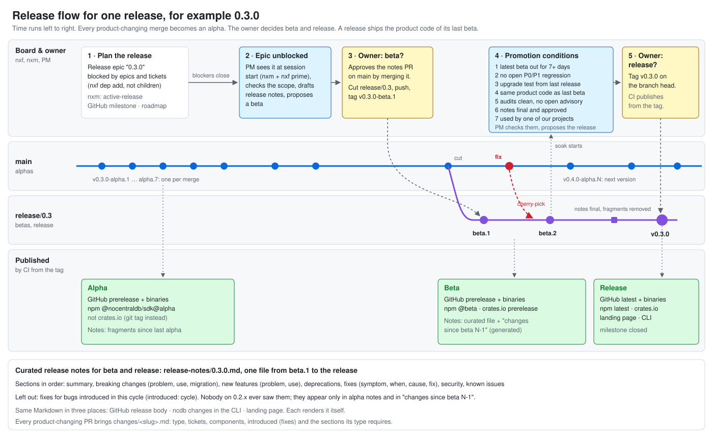

# Release management

> **Work in progress.** This page describes the release process as it will work. We are still building parts of it, so a script, workflow or check named here may not exist yet.

This page describes how NoCentralDB is versioned, how a change reaches a user, and who does what at each stage. It is for maintainers and for the agents that work in this repository.

## Overview

NoCentralDB publishes a Rust core (`ncdb-core`), a Rust SDK (`nocentraldb`), the TypeScript SDK `@nocentraldb/sdk`, the CLI `ncdb` and a relay, all under one version. A change goes through three stages.

- **Alpha.** Every merge to `main` that changes the product becomes an alpha automatically, so people can try it at once.
- **Beta.** When the scope of a planned release is met, the PM proposes a beta and the owner approves it. Then `release/X.Y` is cut from `main`, and the owner tags the beta on that branch.
- **Release.** When the promotion conditions hold, the PM proposes the release, and the owner tags it on the head of `release/X.Y`.

The owner promotes a version by pushing a tag. From the tag, CI produces the GitHub release, the registry packages and the archived notes, built from a commit that CI tested.



## How we plan the work: nexus-flow

AI agents do most of the work in this repository, and the maintainers direct them and review what they deliver. The agents plan and coordinate the work with [nexus-flow](https://github.com/nxsflow/nexus-flow), a toolkit by nxsflow, the company behind NoCentralDB. This page refers to it in several places, so here is what it is.

nexus-flow has three command-line tools that share one local workspace, the `.nxs/` folder in this repository:

- `nxf` is the board. It holds epics and tickets with their dependencies, and it derives what is ready and what is blocked from them. Ticket ids look like `mt08.1qaz`.
- `nxm` is the project memory. It stores the project's rules and decisions, and every agent session starts with them. `NEXUS_MEMORY.md` is a generated copy of that memory, so that people and agents who do not use `nxm` still know the project's rules. We keep the rules there, not in a `CLAUDE.md` or `AGENTS.md`.
- `nxc` connects the agents. Each agent has a role, called a persona, such as the PM who plans releases, the coder, the reviewers or the merger.

We use nexus-flow because the agents need durable state that outlives a single session: a board they can plan against, rules they are reminded of, and roles with clear duties. The board and the memory live in the local workspace of the maintainer who runs them. CI cannot read them, and readers on GitHub cannot open a ticket id.

Maintainers are welcome to work with nexus-flow too. A maintainer who joins starts with a workspace of their own and does not see the existing tickets at first. We plan to let public projects open their boards, and to let maintainers and contributors connect their own agents to the same board, through [manufakt.io](https://manufakt.io).

You do not need nexus-flow to contribute. Everything that matters for a contribution happens on GitHub: issues, pull requests, milestones and releases. Where this page names a ticket, a memory or the PM, it describes how the agents of the maintainers work.

## Versioning

- Versions follow SemVer with prerelease suffixes. Tags look like `v0.3.1-alpha.4`, `v0.3.1-beta.2` and `v0.3.1`. The stage is part of the version, so the registries understand it. The tooling refuses any other tag shape.
- Everything the project publishes (crates, npm packages, CLI, relay) shares one version and always moves in lockstep. The unscoped npm package `nocentraldb` stays a parked `0.0.0` placeholder outside the shared version.
- **Where the version lives.**
  - Committed manifests hold only the plain version `X.Y.Z`, never a stage suffix. That is `[workspace.package] version` in `Cargo.toml`, which every crate inherits with `version.workspace = true`, and the `version` of every `package.json` under `packages/*` and `apps/*`. The workspace declares inter-crate dependencies in `[workspace.dependencies]` with `path` and `version = "=<version>"`, and each crate uses them as `name.workspace = true`.
  - CI writes the full version (`X.Y.Z-alpha.N`, `X.Y.Z-beta.N` or `X.Y.Z`) from the tag into the manifests of its build checkout, right before it builds and publishes. It then refreshes the workspace members' entries in `Cargo.lock` with `cargo update --workspace --offline`. Nothing about the stage is committed. That is why a release can use exactly the product code of its last beta.
  - The project gate fails when the manifests disagree with each other. For beta and release tags, the release workflow also fails when the tag's `X.Y.Z` differs from the manifests.
- **The checks.** `node scripts/release/check-version.mjs` runs in `pnpm gates` as the task `repo:version`. It fails and names the file when one of these holds:
  1. `Cargo.toml` has no `[workspace.package] version`, or the version is not a plain `X.Y.Z`. A `-` or `+` suffix fails, because committed manifests never carry a stage suffix.
  2. A `crates/*/Cargo.toml` declares its own `version`, or does not say `version.workspace = true`.
  3. A `crates/*/Cargo.toml` declares a `path =` dependency itself, in `[dependencies]`, `[dev-dependencies]`, `[build-dependencies]` or their `[target.….…]` forms.
  4. A `[workspace.dependencies]` entry with a `path` is not pinned with `version = "=<workspace version>"`.
  5. A `package.json` under `packages/*` or `apps/*` has a different `version`, or none.
  6. `Cargo.lock` does not list a workspace crate at the workspace version. Run `cargo update --workspace --offline` to fix it.
  7. With `--tag <tag>`, the tag is not `vX.Y.Z` or `vX.Y.Z-beta.N`, or its `X.Y.Z` is not the workspace version. The check refuses alpha tags, because alphas are never checked against the manifests.

  The check's reader of `Cargo.toml` and the crate manifests is narrow and fails closed. Inside the tables it reads, it understands only single-line keys of the shapes above. A multi-line value, a trailing comment on a line it parses, a dotted dependency key other than `name.workspace = true`, or a dependency sub-table such as `[workspace.dependencies.x]` fails with "unsupported manifest syntax at line N".
- **Dependencies between workspace crates.** Declare each one once, in `[workspace.dependencies]` of `Cargo.toml`, as `name = { path = "crates/name", version = "=X.Y.Z" }`, and use it in a crate as `name.workspace = true`. The exact `=` pin lets a prerelease resolve. Cargo matches a requirement such as `1.2.0`, which means `^1.2.0`, against no prerelease, so without the pin `1.2.0-beta.1` of a sibling crate would not resolve.
- **Writing a version.** `node scripts/release/set-version.mjs <version> [--no-lock]` does four things. It writes a full version (`X.Y.Z`, `X.Y.Z-alpha.N` or `X.Y.Z-beta.N`) into `[workspace.package]`. It pins every `[workspace.dependencies]` path entry to `=<version>` and inserts the pin where it is missing. It sets `version` in every `packages/*/package.json` and `apps/*/package.json`, replacing only that value and leaving every other byte of the file as it was. Then it runs `cargo update --workspace --offline`, unless you pass `--no-lock`. It validates the version and reads every manifest before it writes any. If the lock refresh fails, it restores every file it wrote, and `Cargo.lock`, as they were, and says so: a rewritten manifest never stays beside a stale lock. The alpha and publish jobs run it in their build checkout. The cut runs it on the release branch, with a plain version.
- **The lock refresh offline.** The test of `set-version` runs `cargo update --workspace --offline` on a two-crate fixture and checks that it moves both workspace members to a prerelease version. Whoever adds a new kind of dependency to the workspace, such as the first third-party crate, verifies again that the command still succeeds offline. If it fails offline, `set-version` falls back to rewriting the `version` lines of the workspace members' `[[package]]` blocks in `Cargo.lock` directly, with the lock reader `lockVersions` of `scripts/release/lib/manifests.mjs`.
- **The next version** follows from the change fragments since the last release.
  - The last release is the highest entry with stage `release` in `release-notes/index.json`. The tooling never infers it from the existence of a `vX.Y.Z` tag, because a refused release tag stays in place.
  - A `breaking` fragment bumps the minor version before 1.0, and the major version from 1.0 on. A `feature` fragment bumps the minor version. Otherwise the patch version goes up.
  - The target version is the higher of that bump result and the manifest version on `main`. As long as no release exists, the target is the manifest version, whatever the fragment types. After a cut, the manifests on `main` already say `X.(Y+1).0`.
  - Alpha and beta numbers count up within the target version. `N` is one above the highest existing `v<target>-alpha.N` (or `-beta.N`) tag. Alpha numbers come from the existing alpha tags, because alphas never go into the index. A gap after a failed run does no harm.
  - An example of a target change: after 1.2.0 ships, `main` says 1.3.0 and produces `1.3.0-alpha.N`. When a `breaking` fragment arrives, the target becomes 2.0.0, and the next alpha is `2.0.0-alpha.1`.
  - The alpha job computes all of this itself with `node scripts/release/next-version.mjs` and commits nothing. The committed manifest version goes up only when a release branch is cut.

## Branches

- `main` always moves forward and produces alphas of the next version.
- `release/X.Y` stabilises one minor line and ships its patches. Betas and releases come only from a release branch. We do not maintain older lines in parallel, and there is no long-term support before 1.0.
- **Cutting the branch.** When the owner approves a beta, `release/X.Y` is cut from `main` at the merge commit of the approved release-notes pull request (see [Beta](#beta)).
  - On the branch, one commit sets the manifests to `X.Y.Z`. For the first cut of a minor line, the manifests on `main` already say `X.Y.0`, and no commit is needed.
  - On `main`, a pull request sets the manifests to `X.(Y+1).0`, so the alphas on `main` sort above the release line. It carries the `skip-changes` label, because it changes nothing a user gets.
  - The cut tool creates `release/X.Y` locally and prints the push command. The owner pushes the branch, or the PM does on the owner's word.
- **Fixes during beta** land on `main` first, with their fragment. Then they are cherry-picked to the branch, fragment included. The branch holds nothing that is not on `main`, except the release notes and the manifest version.
- **Which fragments belong to which release.** A release ships the fragments present at the cut, plus every fragment cherry-picked to the branch afterwards. After the release, the release workflow's commit on `main` removes every fragment that shipped in `X.Y.Z`, so the next release's notes never repeat it.
- **Patch releases** `X.Y.(Z+1)` follow on the same branch and go through beta again. The owner approves, `node scripts/release/cut.mjs X.Y.(Z+1)` sets the branch's manifests to `X.Y.(Z+1)` on its head, a new notes file `release-notes/X.Y.(Z+1).md` is drafted, and `vX.Y.(Z+1)-beta.1` is pushed on the branch head.
- Never commit `NEXUS_MEMORY.md`, or anything else that is not a cherry-picked fix, the release notes or the version, on a `release/*` branch.

## Writing a change fragment

Every pull request that changes the product carries one change fragment.

- **Location.** A fragment is a file `changes/<slug>.md` with YAML front matter and a Markdown body. The slug matches `^[a-z0-9][a-z0-9-]*$`. `changes/README.md` is the short writer's guide, and this page holds the full rules.

Front matter:

| field | values | required |
| --- | --- | --- |
| `type` | `breaking`, `feature`, `fix`, `deprecation`, `security`, `internal` | yes |
| `tickets` | nexus-flow ticket ids or Linear issue ids, e.g. `[mt08.1qaz]` or `[NOC-12]`; each matches `^[a-z0-9]+\.[a-z0-9]+$` or `^[A-Z][A-Z0-9]*-[1-9][0-9]*$` | yes |
| `issues` | GitHub issue numbers of this repository, e.g. `[42, 57]`; a non-empty list, each a positive integer, none twice. The notes link each one: alpha notes with a link to the issue, the generated part of beta notes and the `draft-notes` skeleton as `#42`, which GitHub links in a release body. | no |
| `introduced` | for `fix`: `cycle` (the bug only existed since the last release) or the released version `X.Y.Z` that introduced it | yes for `fix`, forbidden otherwise |
| `components` | non-empty list from `core`, `sdk-rust`, `sdk-ts`, `cli`, `relay` | yes |

Each type requires these body sections, as level-2 headings:

- `breaking` and `feature`: **Problem** (what a user could not do, or did badly) and **Use** (how to use it, with a short example). `breaking` also needs **Migration** (what to change).
- `fix`: **Symptom** (what went wrong), **When** (in which situations it was visible), **Cause** (why it existed) and **Fix** (how we solved it).
- `deprecation`: **Deprecated**, **Replacement**, and **Removed in** (the earliest version that removes it).
- `security`: **Description** (short and public) and **Advisory** (the advisory id once it is published, `pending` until then).
- `internal`: one line and no sections. Curated notes never show it.

The checks:

- **Schema check.** The gate task `repo:fragments` runs `node scripts/release/check-fragments.mjs`. It checks every `changes/*.md` except `README.md`. Each fragment must use LF line endings, must parse, with its front matter closed by a line that is exactly `---`, must have the required fields with allowed values and no other field, and must have exactly the body sections its type requires, as level-2 headings. A `##` line inside a fenced code block is not a section. The check runs locally in `pnpm gates` and in CI. A malformed fragment turns `pnpm gates` red, and each violation is one line, `check-fragments: changes/<slug>.md: <rule>`. A repository without `changes/` passes.
- **Required-fragment check.** The workflow `.github/workflows/changes.yml` runs the check named `changes` on pull requests to any base. It compares the pull request's changed paths with the allowlist below. If any path is outside the allowlist and the pull request adds no fragment under `changes/`, the check fails and names each such path: `check-fragments: <path> ships to a user and the pull request adds no fragment under changes/ (add one, or label the PR skip-changes)`. After the paths it prints, once, how to add a fragment: the file name and slug rule, the front matter with the allowed values, and links to `changes/README.md` and this section, so the CI log alone is enough to fix it. The check needs only `contents: read`, because the labels come with the event payload. In detail:
  - The check diffs from the merge base of the pull request's base and head, so commits on the base branch after the fork never count. Deleted paths count. A moved file counts as both its old and its new path.
  - Only a fragment that the pull request *adds*, as a new `changes/<slug>.md`, satisfies the rule. Editing or renaming an existing fragment does not, and neither does a file under `changes/` that is not a fragment, such as `README.md` or a file with a bad slug.
  - The check validates every fragment that the pull request adds or modifies against the schema, as it stands at the head commit, with or without the label.
  - The workflow runs `node scripts/release/check-fragments.mjs --base <base sha> --head <head sha> [--skip]`. The same command reproduces it locally, for example with `--base origin/main --head HEAD`.
- **Breaking-change detection,** also part of `changes`. `cargo-semver-checks` compares each workspace crate against the pull request's base commit, and the workflow regenerates and diffs the TypeScript SDK's API report. A reported breaking Rust change, or a removed or changed line in the API report, fails `changes` and names the item, unless the pull request adds a `breaking` fragment. In detail:
  - The base is checked out as a worktree, and `cargo-semver-checks-action` compares the crates with it (`baseline-root`). Its `baseline-rev` input is not used, because it extracts the base as an archive and refuses a symlink in the repository whose target lies outside the tree. The action runs on the toolchain `rust-toolchain.toml` pins (`rust-toolchain: manual`). It may fail without failing the job, so that the fragment step still runs; any failure of it, a tool error included, counts as a breaking change. The job then shows a warning: when the semver log names no failed lint, the tool itself failed (a download or build error), and the way out is to re-run the job, not to add a `breaking` fragment.
  - `node scripts/release/api-report.mjs --base <base sha>` first checks that the committed report is current (exit 1 otherwise), then compares it line by line with the base's report. Each line the base has and the pull request no longer has is printed as `api-report: breaking: - <line>`, and the step reports `breaking=true` (exit 3). A report missing at the base counts as empty. Comments are not part of the report, so a doc comment edit is never breaking. The comparison is a heuristic over lines, not over declarations: a line that moves from one declaration to another with the same text is not reported, and neither is a new required member of a type that callers pass in, which is only an added line. A reviewer still judges those by hand.
  - Either finding adds `--require-breaking` to `check-fragments`, which then fails with `a breaking change was detected and no breaking fragment was added (the skip-changes label does not waive this)` until the pull request adds a fragment of type `breaking`.
  - Locally: `node scripts/release/api-report.mjs --base origin/main`, and for the crates `git worktree add --detach <dir> origin/main` followed by `cargo semver-checks --baseline-root <dir>`.
- **The `skip-changes` label.** With the label on the pull request, the required-fragment check passes, because the workflow passes `--skip`. Adding or removing the label runs the check again, because the workflow runs on `labeled` and `unlabeled`. The label never waives a detected breaking change. That still needs a `breaking` fragment, because `--require-breaking` ignores `--skip`. The label is meant for pull requests that change product paths but ship nothing to a user, such as a version raise or a lockfile refresh.

**Allowlist.** A pull request needs no fragment when every changed path matches one of these: `docs/**`, `README.md`, `AGENTS.md`, `CONTRIBUTING.md`, `NEXUS_MEMORY.md`, `factory/**`, `LICENSE-*`, `.github/**`, `scripts/**`, `moon.yml`, `**/moon.yml`, `.moon/**`, `biome.json`, `tsconfig.base.json`, `.prototools`, `.nvmrc`, `.gitignore`, `**/tests/**`, `**/test/**`, `**/*.test.*`, `changes/**`, `release-notes/**`. Every other path ships to a user and needs a fragment or the label. That includes `Cargo.toml`, `Cargo.lock`, every `package.json`, `pnpm-lock.yaml`, `pnpm-workspace.yaml`, `rust-toolchain.toml` and every `src/`. Lockfile updates need a fragment or the label too, including Dependabot's.

**Lifecycle.** Fragments stay in place at alpha and beta. On `release/X.Y`, the last notes pull request before the release tag removes the release's fragments. On `main`, the release workflow's commit after the release removes them. Git history keeps them.

## Release notes

- **One Markdown file per release version**, `release-notes/<X.Y.Z>.md`. The same file serves from `beta.1` to the release. It is edited on `release/X.Y` before each beta, and the release archives it on `main`. `node scripts/release/draft-notes.mjs <X.Y.Z>` writes its skeleton (see [Beta](#beta)). Under each entry's heading, the skeleton keeps a comment with the fragment's slug and tickets. Leave it in: `promotion-check` looks up the tickets of every breaking change in the notes.
- **"Changes since beta N-1".** For a beta's GitHub notes, the publish job generates this section at publish time from the fragments added on the branch since the previous beta tag. The section is never committed. `render-notes --beta X.Y.Z --since <previous beta tag|none>` prints the curated file as it is at the commit. After a previous beta it adds a section `## Changes since <tag>` with those fragments, unfiltered, so a cycle fix appears there, each under `### <slug>`. `render-notes --release X.Y.Z` prints only the file.
- **`release-notes/index.json`** lists one entry per published beta and release, newest last, sorted ascending, with unique tags:

  ```json
  { "releases": [ { "version": "1.2.0", "stage": "beta", "tag": "v1.2.0-beta.1", "date": "YYYY-MM-DD", "path": "release-notes/1.2.0.md" } ] }
  ```

  Every entry has exactly these five keys.
  - `version` is a plain `X.Y.Z`.
  - `stage` is `beta` or `release`, and `tag` matches it: `vX.Y.Z` for a release, `vX.Y.Z-beta.N` for a beta. With `tag`, a consumer can fetch the file as it was at that tag.
  - `date` is the UTC calendar day of publishing, as `YYYY-MM-DD`: a real day, with no time and no time zone.
  - `path` is `release-notes/<version>.md`.

  The release workflow adds an entry with `node scripts/release/index.mjs add --version X.Y.Z --stage beta|release --tag <tag> --date <UTC day>` and commits the file to `main`. Adding an identical entry again changes nothing and prints `already indexed`. Adding an entry for an indexed tag that differs in any field fails. `validateIndex` in `scripts/release/index.mjs` holds the committed file to this shape in `repo:test`. Before the first beta the file is `{ "releases": [] }`.
- **Order of sections** in curated notes:
  1. a summary of the release, two or three sentences long;
  2. **Breaking changes**, each with problem, use and migration;
  3. **New features**, each with the problem and then the use;
  4. **Deprecations**;
  5. **Fixes**, each with symptom, when, cause and fix;
  6. **Security**;
  7. **Known issues**: bugs introduced in this cycle that we know of and have not fixed yet, each with a workaround if there is one.
- **The filter.** A `fix` with `introduced: cycle` never appears in curated notes, because a user of the previous release never saw that bug. It still appears in alpha notes and in "Changes since beta N-1". `internal` fragments never appear in curated notes.
- **Tone.** Write factually, for the user of the product. The notes may say why a feature is worth having, but they make no claim the product does not back. Keep each entry to one paragraph, plus a code block where it helps. The notes are in English only.
- **Where the notes appear.**
  - **GitHub.** The release body is the file's content. Betas after the first also carry the generated "Changes since beta N-1" section. Alpha prereleases carry the alpha notes instead (see [Alpha](#alpha)).
  - **CLI.** `ncdb changes` prints the notes of the installed version. For an installed beta, it prints the curated file as it was at that beta's tag, found through `tag`. `ncdb changes <from>..` prints the curated notes of every release after `<from>`, read from `index.json` and the files on `main`, and never alpha fragments. The CLI may print a one-line hint when a newer release exists. It renders the Markdown for the terminal itself.
  - **Landing page.** The landing page shows released versions only, rendered from `index.json` and the files on `main`, plus the roadmap from open milestones.

## Alpha

You do nothing by hand. Merge a product-changing pull request with its fragment to `main`, and the alpha follows once `ci` is green.

The `release` workflow (`.github/workflows/release.yml`) runs on `workflow_run` of the `ci` workflow (`types: [completed]`, `branches: [main]`). Its job `alpha` proceeds only for a run that meets all of these conditions: its `conclusion` is `success`, its `event` is `push`, its `head_branch` is `main`, and its `head_repository` is this repository. A run triggered by a pull request never qualifies, a fork's included, because the job holds `contents: write`. The workflow itself has only `contents: read`. The job runs in the concurrency group `release-alpha`, which never cancels a run in progress, for at most 20 minutes, and every step runs in `bash` with `pipefail`. The commit is the run's `head_sha` (`github.event.workflow_run.head_sha`, or `github.sha` on a dispatch). The job then works through these steps:

1. **Guard.** Before any checkout, the job reads the head of `main` with `git ls-remote --exit-code`, using the runner's own git and the job's token. The token reaches git as a basic-auth header, which the job masks in the log first, because the runner masks the token but not a value derived from it. If the commit is no longer that head, the job stops green with a notice and skips every later step. If `ls-remote` fails, the job fails. It never reads that failure as a reason to skip. A dry run on a ref other than `main` fails here, see the dry run below.
2. **Compute.** The job checks out the commit with full history and tags. It does not leave its token in the checkout's git configuration (`persist-credentials: false`); only the publishing step gets the token. It installs the toolchain and runs `node scripts/release/next-version.mjs --json` (see [Versioning](#versioning)). That prints the answer to the log and to `next.json` in the checkout. It commits nothing.
3. **Skip.** If next-version answers `"skip": true`, the job stops green. This happens when none of the fragments added since the previous alpha has a `type` other than `internal`. The previous alpha is the nearest alpha tag reachable from the commit. Before the first alpha, the job looks at every fragment present.
4. **Render.** The job renders the alpha notes with `node scripts/release/render-notes.mjs --alpha --since <previous alpha | none> --repo <owner/name>`. The notes list every fragment added since the previous alpha, in slug order. Each fragment gets a heading `## <slug>`, a line `*<type>* · components: … · tickets: …` that ends with `· issues: …` and a link to each GitHub issue when the fragment lists any, and its body with its sections demoted to `###`. The notes end with `Previous alpha: [<tag>](<its release>)` or `First alpha.` Alpha notes are raw, so they list `internal` fragments and `introduced: cycle` fixes too.
5. **Publish.** The job publishes a GitHub prerelease `v<next>-alpha.<n>` with the notes as its body, and the tag with it. `gh release create "$TAG" --target "$SHA" --prerelease` creates the tag on the commit and the release in one API call. There is no separate `git tag` or `git push`, so the job never leaves a tag without a release. If a tag of that name already exists on the remote without a release, the step fails and creates nothing, because `gh release create` would attach the release to that tag and ignore `--target`. Check what the tag points at and delete it if it is an orphan, then re-run. If the step fails, it created nothing, and a re-run computes the same alpha again. If the release already exists because an earlier run succeeded, the step creates nothing. On such a re-run, next-version answers `skip` anyway, because the tag already sits on the commit. The job attaches the binary of every component that ships one, such as the CLI and the relay, after the release exists, and a re-run completes missing uploads. Every publishable npm package gets the alpha under the dist-tag `alpha`.

Alphas never go to crates.io. crates.io versions are permanent, and one version per merge would bury the real versions. Rust users who want an alpha depend on the git tag.

Sometimes no alpha appears. That is expected in three cases:

- **All-internal merges.** A merge whose fragments are all `internal`, or that needed no fragment, produces no alpha, because next-version answers `skip`.
- **The commit is no longer the head of `main`.** When two merges land in quick succession, the older one must not produce an alpha with a higher number on older code, so the guard skips it. The next alpha covers it, because the job computes alpha notes since the previous alpha tag, not per merge. Nothing is lost.
- **The workflow's own pushes to `main`.** The release workflow's commit after a beta or release starts no `ci` run, so no alpha follows it. While such a push is the head of `main`, the guard also skips the run of the merge before it. That merge's alpha is delayed by one run, and the alpha of the next product-changing merge covers it.

A tag pushed with the workflow's own `GITHUB_TOKEN` does not start another workflow run. The publish job also ignores `-alpha.` tags explicitly.

**Dry run.** A `workflow_dispatch` is always a dry run. With an empty `tag` input, it runs the alpha job:

```sh
gh workflow run release.yml --ref main
gh run watch "$(gh run list --workflow release.yml --event workflow_dispatch --limit 1 --json databaseId --jq '.[0].databaseId')"
git ls-remote --tags origin 'v*-alpha.*'   # unchanged: a dry run tags nothing
```

Its log shows the guard's verdict and the answer of next-version, which is the content of `next.json`: either `"skip": true` with the reason, or the version, the tag, the previous alpha and the fragments. When it does not skip, the log also shows the rendered notes. The dry run skips the tag-and-publish step (`DRY_RUN`), so it tags and publishes nothing. A dispatch on a ref other than `main` fails at the guard with an error that names the ref, and computes nothing: its commit is never the head of `main`, so it would otherwise skip every step and end green without proving anything. Only a dispatch on `main` proves the job. A dispatch with a non-empty `tag` is the publish dry run (see [Beta](#beta)), and it does not run the alpha job. Every dispatch, with or without a tag, also runs the job `app-token-check`, which checks the release app's setup (see [The bypass for commit-back](#the-bypass-for-commit-back)).

**Reproducing it locally.** `node scripts/release/next-version.mjs [--json] [--head <ref>]` and `node scripts/release/render-notes.mjs --alpha --since <tag|none> --repo nocentraldb/nocentraldb [--head <ref>]` give the same answer for the same commit, as long as your local tags match `origin` (`git fetch --tags`). Both read every file as it stands at the commit, never from the working tree.

## Beta

1. **Propose (PM).** When the release epic is no longer blocked, the PM compares the epic's description with what was delivered. If the scope is met, the PM proposes a beta to the owner and attaches a draft of the release notes. If not, the PM says what is missing.
2. **Draft (PM or agent).** The PM or an agent drafts `release-notes/<X.Y.Z>.md` (see [Release notes](#release-notes)) from two sources. The first is every fragment since the previous release, which `draft-notes` renders into the skeleton with the filter applied and the sections in order. The second is every board item created or closed since the release epic was created, read with `nxf`; it matters most for Known issues.

   ```sh
   node scripts/release/draft-notes.mjs X.Y.Z
   ```

   It writes `release-notes/X.Y.Z.md` and refuses to overwrite an existing file unless you pass `--force`. Each entry is titled by the first line of its first section and shows the sections as bold labels; rewrite the titles and the text for the user. A trailing comment lists the fragments the filter left out. The script also warns about every `introduced: cycle` fix that was added before the previous release was cut (the highest release in `release-notes/index.json`, or `--previous vA.B.C`). Such a bug may have shipped in that release. The script does not change the fragment, because only the PM can tell whether the bug reached the release branch. If it did, change the fragment to `introduced: A.B.C` in the same pull request.
3. **Pull request to `main`.** The draft goes into a pull request against `main`. The owner edits and approves it there. Merging it is the approval.
4. **Cut (`cut`).** After the merge, cut `release/X.Y` from the merge commit (see [Branches](#branches)):

   ```sh
   node scripts/release/cut.mjs X.Y.Z --from <merge commit of the notes pull request> [--push]
   ```

   It refuses a detached HEAD, a working tree that is not clean, and a `release/X.Y` that already exists locally or on `origin`. It sets the manifests on the branch and commits only if they changed; for the first cut of a minor they already say `X.Y.0`, and it makes no commit. It always switches back to the branch it started from, also when a step fails, so the next commit, such as a `NEXUS_MEMORY.md` commit, cannot land on the release branch. Then it prints the next steps: the push command (unless `--push`), the commands for the pull request that raises `main` to `X.(Y+1).0` with the label `skip-changes`, and the owner's beta tag command.
5. **Push the branch.** The owner pushes `release/X.Y`, or the PM does on the owner's word, with `--push` or the printed command.
6. **Raise `main`.** The PM opens the raise pull request with the printed commands.
7. **Tag (owner).** The owner pushes the beta tag on the branch head:

   ```sh
   git tag vX.Y.Z-beta.1 release/X.Y && git push origin refs/tags/vX.Y.Z-beta.1
   ```

On the tag, the publish job takes over. The `release` workflow runs on `push` of tags `v*` and excludes `-alpha.` tags. Four jobs run in order, each with its own permissions:

- **`verify`** (read-only) fetches the release branches, checks the tag with `verify-tag` on the tagged commit, and then runs the full gate `pnpm gates` on that commit itself.
- **`build`** (read-only) writes the full version from the tag into its own checkout with `set-version`, and builds.
- **`publish`** (`contents: write`) publishes.
- **`commit-back`** (`contents: read` for the workflow's own token) makes the one commit to `main` with a short-lived token of the release app, the organization GitHub App on the ruleset's bypass list (see [The bypass for commit-back](#the-bypass-for-commit-back)). The token reaches git as a basic-auth header, masked in the log like the alpha guard's.

All four jobs share one concurrency group per ref, `release-publish-<ref>`, which never cancels a running job. Two runs of the same tag, such as a re-run while the first is still in flight, therefore never run two of these jobs at once, so they never overlap in `publish` or `commit-back`. GitHub still cancels an older job of the group that is only waiting when a newer one queues; that run stays unfinished, and the newer run does the whole work.

The `publish` job publishes a GitHub prerelease whose body is the curated file. For betas after the first, it adds the generated section "Changes since beta N-1", which lists the fragments added on the branch between the two beta tags (`git diff --diff-filter=A --name-only <previous beta tag> <this tag> -- changes/`). It also publishes every publishable package to npm under the dist-tag `beta`, and to crates.io as a prerelease version. Finally `commit-back` appends the beta to `release-notes/index.json` on `main`, with `commit-back.mjs` (see [Release](#release)). The GitHub release step first checks whether the release exists and creates nothing if it does, so a re-run is safe. Each registry step reports `skip <name>: <reason>` for every package that `publishable` says no to.

**Dry run.** A `workflow_dispatch` with a non-empty `tag` input is the publish dry run. It runs `verify` and `build`, and `app-token-check` as every dispatch does, and never `publish` or `commit-back`. The tag is only a name: `verify-tag` checks it against the dispatched ref's head commit, which need not carry the tag yet. Dispatch on the release branch to prove a tag before you push it:

```sh
gh workflow run release.yml --ref release/X.Y -f tag=vX.Y.Z-beta.N
gh run watch "$(gh run list --workflow release.yml --event workflow_dispatch --limit 1 --json databaseId --jq '.[0].databaseId')"
```

The log shows the verdict of `verify-tag`, the gate and the build. A tag whose version is not the version in the manifests at that commit fails `verify` at rule 2 of the list below. A dispatch on a ref that is not on `release/X.Y`, such as `main`, fails at rule 3.

If the publish job may not publish a tag, `verify` turns red before anything is built or published. The tag stays in place for the owner to delete or move. `scripts/release/verify-tag.mjs --tag <tag> --commit <sha>` holds the rules. It checks them in this order and stops at the first failure:

1. The tag is `vX.Y.Z` or `vX.Y.Z-beta.N`. This job never publishes alpha tags.
2. `X.Y.Z` is the workspace version in `Cargo.toml` at the commit.
3. The commit is reachable from `origin/release/X.Y`.
4. For a release only: a `vX.Y.Z-beta.N` tag exists, because every release passes through beta.
5. For a release only: the commit is the head of `origin/release/X.Y`.
6. For a release only: since the last beta, only `release-notes/` and `changes/` changed. The last beta is the highest `vX.Y.Z-beta.N` of the same `X.Y.Z`, compared numerically, so `beta.10` is above `beta.2`.
7. For a release only: `changes/` holds no fragment at the commit.
8. `release-notes/X.Y.Z.md` exists at the commit.

With `--json` it prints `{ "stage", "version", "lastBeta" }` for the job. `version` is the plain `X.Y.Z`. For a release, `lastBeta` is the beta that rule 6 compared against. For a beta, it is the previous beta of the same version, which is the `--since` of `render-notes --beta`, or `null`.

`scripts/release/publishable.mjs --json` tells the registry steps which packages to skip. An npm package is publishable when it is not `private` and its `exports` or `main` point under `dist/`. A crate is publishable when its `[package]` has no `publish` key, or has `publish = true`.

**Fixes during beta:**

- Land the fix on `main` first, with its fragment. On `main` it produces alphas of the next version.
- Cherry-pick it to `release/X.Y`, fragment included.
- The fragment carries `introduced: cycle` if the bug only existed since the last release, or `introduced: X.Y.Z` with the released version that introduced it.

**Later betas.** Before each beta tag, a pull request to the branch updates the curated file there. Then the owner pushes `vX.Y.Z-beta.2`, `vX.Y.Z-beta.3` and so on, on the branch head.

**Checks on the release branch.** Pull requests to `release/X.Y` run `ci` and `changes` exactly like pull requests to `main`, because `ci` triggers on every `pull_request`. Only pushes to a release branch do not run `ci`. That is why the publish job runs the full gate on the tagged commit itself.

## Release

The PM checks the promotion conditions in its sessions and proposes the release to the owner when all of them hold. The owner decides.

| # | Condition | Who checks |
| --- | --- | --- |
| 1 | **Soak.** The latest beta has been out for at least 7 days with no newer beta, according to the GitHub release dates read with `gh`. | `promotion-check` |
| 2 | **No open regressions.** No open bug of P0 or P1 has `introduced` in this cycle. Lower ones go under Known issues. | the PM, on the board |
| 3 | **Upgrade tested.** An automated test upgrades from the previous release to the candidate. It covers stored data, `model.lock.json`, an old client against the new relay and a new client against the old relay, and checks convergence throughout. | the upgrade test |
| 4 | **Same product code.** The release is tagged on the head of `release/X.Y`, and since the last beta tag only `release-notes/` and `changes/` have changed. | `promotion-check`; the publish job also refuses the tag otherwise |
| 5 | **Security.** `cargo audit` and `pnpm audit` report nothing, and no security advisory is open. A missing `cargo-audit` counts as a failed condition, never as a pass. | `promotion-check` |
| 6 | **Notes approved.** The owner approved the final curated notes, and every breaking change has a Migration section. | the PM, in the notes pull request; `promotion-check` checks that every breaking fragment's ticket is in the notes |
| 7 | **Real use.** At least one of our own projects runs the beta, with no new bug report. | the PM, on the board |

`node scripts/release/promotion-check.mjs X.Y.Z` fetches `origin` and prints one row per condition, `PASS`, `FAIL` or `MANUAL`, with its evidence. The PM pastes the table into the proposal to the owner. It exits 1 when a mechanical condition fails.

- **1** reads the latest beta, the highest `vX.Y.Z-beta.N` tag by number, and the `publishedAt` of its GitHub release from `gh`. It is `FAIL` when the release is younger than 7 days (shown as `6d 23h`), and also when the tag has no GitHub release or only a draft: a tag alone is not a published beta.
- **4** lists every path changed on `origin/release/X.Y` since that beta outside `release-notes/` and `changes/`.
- **5** runs `cargo audit` and `pnpm audit --audit-level low` in a temporary checkout of `origin/release/X.Y`. A missing `cargo-audit`, `pnpm` or `gh` is a `FAIL` with the install hint. Open security advisories you check by hand.
- **6** is `FAIL` when a `breaking` fragment on the branch has none of its tickets in `release-notes/X.Y.Z.md` there. Once the final notes pull request removed the fragments, the row says the PM checked it. The approval itself is `MANUAL`.
- **2, 3 and 7** are `MANUAL`, with what to check.
- The environment variables `PROMOTION_CHECK_GH`, `PROMOTION_CHECK_CARGO_AUDIT` and `PROMOTION_CHECK_PNPM_AUDIT` and the option `--now` exist for the tests. When one is set, the table says so above the rows and in the rows it affects, and it is not evidence for a release.

Conditions 1, 2, 4, 5 and 6 apply to every release. Condition 3 applies as soon as there is a relay, and condition 7 as soon as one of our projects uses NoCentralDB.

For condition 2, open bugs have no fragment yet. The PM therefore derives `introduced` from the bug ticket's description: when the bug was first seen, and which version or change it came with. If the description does not say, the PM asks and does not guess. The bug's fragment records the value when the fix lands.

Steps:

1. **Final notes pull request** to `release/X.Y`. It makes the curated notes final and deletes the release's fragments from `changes/`. The tooling refuses a release while `changes/` on the branch is not empty.
2. **Tag (owner).** On approval, the owner pushes `vX.Y.Z` on the head of `release/X.Y`:

   ```sh
   git tag vX.Y.Z && git push origin refs/tags/vX.Y.Z
   ```

3. **What the publish job does:**
   1. It runs the gate and `verify-tag`, with the eight rules listed under [Beta](#beta). The tag must match the manifests and sit on the head of `release/X.Y` after a beta. The diff rule of condition 4 must hold: `git diff --name-only <last beta tag> <release tag>` may show only `release-notes/` and `changes/`. No fragment may be left in `changes/`, and `release-notes/<X.Y.Z>.md` must exist at the tag. Any failure turns `verify` red before anything is built or published, and the tag stays in place for the owner to delete or move. The [dry run](#beta) proves the release tag on the branch head before the owner pushes it.
   2. It writes the version into the checkout and builds. The version is embedded, so the bytes differ from the beta's. Then it publishes every publishable package to crates.io and to npm under `latest`, and a GitHub release marked latest whose body is the file's content, without a manual step.
   3. It commits back to `main`, in one commit that the job `commit-back` makes and pushes with `node scripts/release/commit-back.mjs`, in a checkout of `main`. The commit is `Release vX.Y.Z: index, notes archive and shipped fragments` (after a beta: `Beta vX.Y.Z-beta.N: index`, with the index entry only). It contains the updated `release-notes/index.json`, the final `release-notes/<X.Y.Z>.md` as it stands at the tag, and the removal of every fragment that shipped. With the notes file on `main`, `main` becomes the archive that the landing page renders from. The shipped fragments are exactly the files deleted under `changes/` on the branch between the merge base with `main` and the release tag (`git log --diff-filter=D --name-only --format= <merge-base>..<tag> -- changes/`). `node scripts/release/shipped-fragments.mjs --tag vX.Y.Z` lists them with the content that shipped. With `--delete` on a checkout of `main`, it deletes a fragment only when the fragment's content is the blob that shipped. If a new fragment on `main` reused the slug, the script keeps it and names it (`kept <path>: differs from the shipped fragment (slug reused?)`). It never deletes a fragment by its name alone. Before it commits, `commit-back.mjs` holds the index to its shape with `validateIndex` and runs `check-fragments` on what is left in `changes/`. If either fails, it commits nothing. When nothing changed, as on a re-run after a successful one, it prints `nothing to commit` and makes no commit. The index date is the UTC day the GitHub release was published (`gh release view <tag> --json publishedAt`), not the day the job runs, so a re-run on a later day still finds nothing to commit.
   4. It closes the GitHub milestone with `gh`. The landing page picks up the change from `main`.

   The ruleset on `main` requires a pull request, so this push passes only because the release app, whose token the job pushes with, is on the ruleset's bypass list (see [The bypass for commit-back](#the-bypass-for-commit-back)). A push made with an app's token starts the `ci` workflow on `main`, as a merge does, so the gate runs on that commit, including the fragment schema check and the index test. The commit adds no fragment, so the alpha job that follows produces no alpha of its own.
4. **When something fails.** A partial publish, where the GitHub release exists but a registry step failed, leaves the job red and retracts nothing. Re-run it. Every publish step first checks whether its tag, release or package version already exists, and skips it if so. If the commit to `main` fails to push, for example because `main` moved, the job fetches, rebases onto `origin/main`, checks again and retries once. A push that the ruleset refuses (git names a rule violation, `GH013`) fails the retry too: the release app is not on the bypass list, and the owner adds it as [The bypass for commit-back](#the-bypass-for-commit-back) says. If it still fails, the job is red, and a maintainer makes the commit by hand (see [If the commit to main failed](#if-the-commit-to-main-failed)).
5. **After the release.** The PM updates the `active-release` memory (see [Planning a release](#planning-a-release)).

**Patch releases** `X.Y.(Z+1)` go through the same branch and through beta again. The owner approves, the branch's manifests are set to `X.Y.(Z+1)`, `release-notes/X.Y.(Z+1).md` is drafted, and `vX.Y.(Z+1)-beta.1` is pushed on the branch head.

**Withdrawal.** If a published version is broken, we yank it on crates.io and deprecate it on npm, and a fixed version follows at once. Nothing is deleted.

### If the commit to main failed

When the job `commit-back` is red, the GitHub release exists and only the commit to `main` is missing. If its log shows the push refused by a repository rule (`GH013`), the release app is not on the bypass list; if the step "Release app token" failed, the app's Client ID or private key is missing or wrong. Either way, ask the owner to set it up ([The bypass for commit-back](#the-bypass-for-commit-back)), then re-run the failed job. Otherwise re-run the failed job first. If it fails again, make the commit by hand from an up-to-date `main`, with the tag, stage and version from the job's log. The ruleset refuses a direct push to `main` from anyone not on its bypass list, so the commit goes through a pull request:

```sh
git switch main && git pull && git fetch --tags
published="$(gh release view vX.Y.Z --json publishedAt --jq '.publishedAt[:10]')"
node scripts/release/commit-back.mjs --tag vX.Y.Z --stage release --version X.Y.Z --date "$published" --no-push
git switch -c commit-back/vX.Y.Z
git push -u origin commit-back/vX.Y.Z
gh pr create --base main --fill
```

For a beta, pass `--stage beta` and its tag. `--date` is the UTC day the GitHub release was published, read from the release exactly as the job reads it, so the job and a by-hand run index the same day whenever they run. The script starts only from a clean working tree whose `HEAD` is `origin/main`: anything staged, modified or untracked, or a local commit that is not on `origin/main`, stops it before it writes anything, so the commit holds only the release's paths and the push carries only that commit. If a check fails, it resets the working tree and commits nothing. The script makes the same commit as the job. Without `--no-push` it would push that commit to `main` as the job does, which the ruleset refuses to anyone but the release app; with `--no-push` it only commits, and the pull request carries the commit. The pull request needs the `gates` and `changes` checks like any other, and no fragment, since `release-notes/` and `changes/` are on the allowlist. A run that finds nothing to commit prints `nothing to commit`, which means the commit is already on `main`.

### The bypass for commit-back

The ruleset "Require PR" on `main` blocks the branch's deletion, requires a pull request and requires the checks `gates` and `changes`. The job `commit-back` pushes its commit straight to `main`, so the ruleset must let its pusher through. The pusher is the release app: a GitHub App of the `nocentraldb` organization, installed on this repository only, with the repository permission Contents: read and write and nothing else. The job mints a token for it with `actions/create-github-app-token`, narrowed to contents: write on this repository; the token expires after an hour and is revoked when the job ends. The workflow's own token stays read-only in that job.

Only the owner can set this up, once, in the settings:

1. **Bypass.** Open the repository's **Settings → Rules → Rulesets** and select the ruleset **Require PR**. Under **Bypass list**, choose **Add bypass**, search for the release app by its name, select it and add it. Set its mode to **Always allow**, and **Save changes**.
2. **Client ID.** On the app's settings page (the organization's **Settings → Developer settings → GitHub Apps → the release app → Edit**), copy the **Client ID**, which starts with `Iv`; not the numeric App ID, which this workflow does not use. In the repository's **Settings → Secrets and variables → Actions**, on the tab **Variables**, add the repository variable `RELEASE_APP_CLIENT_ID` with that value.
3. **Private key.** On the same app settings page, under **Private keys**, choose **Generate a private key**. GitHub downloads a `.pem` file. In the repository's **Settings → Secrets and variables → Actions**, on the tab **Secrets**, add the repository secret `RELEASE_APP_PRIVATE_KEY` with the file's whole content, then delete the downloaded file.

**Checking the setup.** Run the workflow by hand, as a dry run: in the repository's **Actions → release → Run workflow**, on `main`, with the `tag` field empty (or `gh workflow run release.yml --ref main`). Every `workflow_dispatch` runs the job `app-token-check`. It fails with an error that names `RELEASE_APP_CLIENT_ID` or `RELEASE_APP_PRIVATE_KEY` when either is not set. Otherwise it mints the token exactly as `commit-back` does, lists the repositories the token reaches (read-only), fails if this repository is not among them, and prints the app's slug, never the token. It checks out no code, and it pushes, tags and publishes nothing. So it proves the app, its installation, the variable and the secret. It cannot prove the bypass: only the first real push of `commit-back`, after the first beta tag, shows that the ruleset lets the app through. If that push is refused (`GH013`), the app is not on the bypass list; see [If the commit to main failed](#if-the-commit-to-main-failed).

The bypass covers only this app, not every workflow token: a workflow that pushes with `github.token` is still refused. `scripts/release-ruleset.test.mjs` holds the release workflow to minting the app's token only in `commit-back`, which pushes with it, and in `app-token-check`, which only reads with it. The private key is the one long-lived secret this adds. Whoever holds it can push to `main` past the ruleset, so it lives only in the repository secret, and the owner rotates it on the app's settings page (generate a new key, replace the secret, delete the old key) if it may have leaked. Without the bypass, the variable or the secret, every beta and release ends with `commit-back` red, and the commit goes through a pull request by hand ([If the commit to main failed](#if-the-commit-to-main-failed)).

## Planning a release

- **The release epic.** Each planned release has one epic on the board, for example "Release 1.2.0". Its description states what must be true for the release. Attach the epics and tickets the release needs as **dependencies**, never as children:

  ```sh
  nxf dep add <release-epic> <item>
  ```

  A dependency blocks, while a parent only groups. A deferred or closed parent would also hide its children.
- **The milestone mirror.** The release epic is mirrored publicly as a GitHub milestone, with the version as its title and the public part of the epic as its description. The landing page's roadmap shows the same milestones. Update the milestone when the release is planned and whenever its scope changes. Each item's public visibility is decided per item, and the default is not public.

  ```sh
  # when the release is planned
  gh api repos/{owner}/{repo}/milestones -f title=<X.Y.Z> -f description=<text>
  # when its scope changes (<n> is the milestone's number)
  gh api -X PATCH repos/{owner}/{repo}/milestones/<n> -f description=<text>
  # at the release (the publish job does this)
  gh api -X PATCH repos/{owner}/{repo}/milestones/<n> -f state=closed
  ```

- **The `active-release` memory.** A project memory with the key `active-release` records the release in progress. Its body names the version, the release epic's id, the stage, and this page as the process. The stage is `planned`; or `beta`, with the branch and the latest beta tag; or `released`, with the date. Its introduction line names the version and the epic id.

  The PM writes the memory, because the PM plans releases and is the one that reads it. It writes it at three moments:

  1. when a release is planned, right after the release epic is created (stage `planned`);
  2. when `beta.1` is tagged (stage `beta`, with the branch and the tag), and again after each further beta tag;
  3. when the release ships. The PM rewrites the memory for the next planned release if one exists, and otherwise removes it with `nxm forget active-release`.

  The command:

  ```sh
  nxm remember "<version>, epic <id>, stage <planned|beta: release/X.Y, vX.Y.Z-beta.N|released YYYY-MM-DD>; process: docs/release-management.md" --introduction "Active release <version> (epic <id>): stage <stage>" --key active-release
  ```

  After every write, and after `nxm forget active-release`, commit the regenerated `NEXUS_MEMORY.md` at once, staging only that path:

  ```sh
  git add NEXUS_MEMORY.md && git commit -m "Record the active release <version>" -- NEXUS_MEMORY.md
  ```

  Make that commit on `main` or on the current feature branch, **never on a `release/*` branch**. A commit there would break the same-product-code rule of promotion condition 4. The PM makes exactly this commit and changes nothing else in the working tree.

  While no release is planned, no `active-release` memory exists.

## The PM's duties

The PM is the nexus-flow persona that plans releases (see [How we plan the work](#how-we-plan-the-work-nexus-flow)). At the start of each session it receives the board and the project memory (`nxf prime` and `nxm prime`), so it sees the active release and whether its epic is still blocked. These checks run in agent sessions, never in GitHub Actions, because the board (`.nxs/`) is local and not synced, so CI cannot read it. The PM reads the facts that live on GitHub with `gh`: CI status, release dates and tags. The PM raises a ready beta or release with the owner in its next session.

- **Surface the active release** at session start, from the `active-release` memory and the board.
- **Check the scope** when the release epic is no longer blocked. Raise it with the owner in the next session, compare the epic's description with what was delivered, and either propose a beta with a draft of the release notes or say what is missing.
- **Derive `introduced`** for open bugs from the bug ticket's description: when the bug was first seen, and which version or change it came with. Ask when the description does not say. Never guess.
- **Settle the stale-cycle warnings** of `draft-notes`: for each flagged fix, decide whether the bug reached the previous release, and if it did, set `introduced` to that version in the notes pull request.
- **Run `promotion-check`** for conditions 1, 4, 5 and the mechanical part of 6, and check conditions 2, 6 and 7 on the board and in the notes pull request.
- **Propose** the beta and the release to the owner. The owner decides and pushes the tag.
- **Write the `active-release` memory** at the three moments above, and commit `NEXUS_MEMORY.md`, never on a `release/*` branch.
- **Mirror the release epic** as a milestone (see [Planning a release](#planning-a-release)).

## Supply chain and policies

1. **Provenance.** npm publishes with `--provenance`, and binaries get GitHub artifact attestations (`actions/attest-build-provenance`).
2. **Breaking-change detection.** On every pull request, `cargo-semver-checks` compares each workspace crate against the base commit, and the workflow regenerates and diffs the TypeScript SDK's API report, which is committed under `packages/sdk/etc/` and kept current by the gate task `repo:api-report`. A reported breaking change fails `changes` unless the pull request adds a `breaking` fragment. `cargo-semver-checks` also checks a crate with `publish = false`, so the Rust detector is active before any crate is published. Details in [Writing a change fragment](#writing-a-change-fragment).
3. **No long-lived tokens.** CI publishes to npm and crates.io through Trusted Publishing, which uses OIDC from GitHub Actions, with `id-token: write` on the publish job only. The owner's passkey-protected accounts stay out of automation. The one long-lived secret is the release app's private key, from which `commit-back` mints an hour-long token (see [The bypass for commit-back](#the-bypass-for-commit-back)).
4. **Protected branches and tags.** The ruleset "Require PR" on `main` blocks its deletion, requires a pull request and requires the `gates` and `changes` checks. Its bypass for the release app, and only that app, lets the release workflow push its commit to `main` ([The bypass for commit-back](#the-bypass-for-commit-back)). No ruleset protects the `v*` tags yet.
5. **Withdrawal.** If a published version is broken, we yank it on crates.io and deprecate it on npm, and a fixed version follows at once. Nothing is deleted.
6. **Security advisories.** We publish them through GitHub Security Advisories, with a Security section in the notes.
7. **Deprecation policy.** We mark anything we plan to remove as deprecated, and announce it in the notes, at least one release before we remove it.

**Published packages.** On crates.io: `ncdb-core` (core), `nocentraldb` (Rust SDK) and `ncdb` (the CLI, so that `cargo install ncdb` works). On npm: `@nocentraldb/sdk`. GitHub releases carry the CLI and relay binaries. All packages share one version. The publish steps skip a package that is not publishable (`private: true`, `publish = false`, or no package at all) and do not fail because of it.

**A new package's first publish.** Trusted Publishing can only be configured for a package that exists. The owner therefore publishes each new package once by hand, before configuring it. Every later publish goes through CI. Each name is held on its registry by a `0.0.0` placeholder, so the first real version of a package must be above `0.0.0`. A crate drops `publish = false` when it first ships, and `@nocentraldb/sdk` drops `private: true` and gets a build output under `dist/`, so that `publishable` lets it through.

**A public repository.** The repository has been public since 2026-11-09, before the first release. Provenance, artifact attestations, the public milestone and the ruleset on `main` all rely on that: on a private repository, GitHub releases and their binaries would be visible to collaborators only.

## Tooling reference

| Unit | Does |
| --- | --- |
| `scripts/release/lib/` (`cli.mjs`, `fragments.mjs`, `git.mjs`, `glob.mjs`, `test-repo.mjs`, `semver.mjs`, `manifests.mjs`) | shared command-line helpers; shared parsing of fragments, git, allowlist globs, SemVer and tags, and manifests; isolated git repositories for tests |
| `scripts/release/check-fragments.mjs [--dir <changes>]` | validates every `changes/*.md`; with `--base <rev> --head <rev> [--skip]`, also applies the allowlist and the required-fragment rule; `--require-breaking` ignores `--skip` |
| `scripts/release/check-version.mjs [--tag <v…>]` | checks that the manifests agree on a plain `X.Y.Z`, that inter-crate dependencies are pinned in `[workspace.dependencies]`, and that `Cargo.lock` follows; with `--tag`, checks that the tag matches the manifests for beta and release |
| `scripts/release/set-version.mjs <version> [--no-lock]` | writes the version into `Cargo.toml` `[workspace.package]`, pins the `[workspace.dependencies]` path entries to `=<version>`, sets every workspace `package.json`, then runs `cargo update --workspace --offline` |
| `scripts/release/next-version.mjs [--json] [--head <ref>] [--index <file>]` | computes the next alpha tag from the tags, the fragments and the workspace version at the commit and from `release-notes/index.json`, or answers `skip` with its reason |
| `scripts/release/render-notes.mjs --alpha --since <tag\|none> --repo <owner/name> \| --beta <X.Y.Z> --since <tag\|none> \| --release <X.Y.Z> [--head <ref>]` | prints the GitHub release body: the alpha notes; the curated file plus "Changes since" the previous beta; or the curated file only |
| `scripts/release/verify-tag.mjs --tag <tag> --commit <sha> [--remote <name>] [--json]` | applies the refusal rules for beta and release tags (see [Beta](#beta)) |
| `scripts/release/index.mjs add --version --stage --tag --date [--file]` | appends to `release-notes/index.json`, sorted and idempotent; exports `validateIndex` |
| `scripts/release/shipped-fragments.mjs --tag <vX.Y.Z> [--main <ref>] [--delete]` | lists the fragments that shipped, with their blobs; `--delete` removes those on `main` whose content is that blob |
| `scripts/release/publishable.mjs [--json]` | lists which packages the publish steps may publish, each with its reason |
| `scripts/release/commit-back.mjs --tag <tag> --stage <beta\|release> --version <X.Y.Z> --date <YYYY-MM-DD> [--main <remote/branch>] [--no-push]` | makes the release workflow's commit to `main`: the index entry; for a release also the notes archive and the removal of the shipped fragments; starts only from a clean tree on `origin/main`, checks the index and the fragments first, commits nothing when nothing changed, and retries a failed push once after a rebase |
| `scripts/release/draft-notes.mjs <X.Y.Z> [--out <file>] [--previous <vA.B.C>\|auto] [--force]` | writes the curated-notes skeleton, with the filter applied and the sections in order; warns about cycle fixes added before the previous release |
| `scripts/release/cut.mjs <X.Y.Z> [--from <commit>] [--push]` | creates `release/X.Y` (or, for a patch, uses its head), sets the manifests and commits only a change, returns to the starting branch, and prints the push, raise-PR and beta-tag commands |
| `scripts/release/promotion-check.mjs <X.Y.Z> [--now <ISO date>] [--remote <name>]` | reports the promotion conditions as a table, `PASS`, `FAIL` or `MANUAL` with evidence: soak from the GitHub release, the product code since the last beta, the audits, the breaking changes' tickets in the notes |
| `scripts/release/api-report.mjs [--write \| --base <rev>] [--project <dir>]` | regenerates the TypeScript SDK's public declarations with `tsc` and fails when the committed `packages/sdk/etc/api-report.d.ts` differs; `--write` rewrites it; `--base` also names each line removed or changed since `<rev>` and exits 3 |
| moon task `repo:fragments` | runs `node scripts/release/check-fragments.mjs` in `pnpm gates` |
| moon task `repo:version` | runs `node scripts/release/check-version.mjs` in `pnpm gates` |
| moon task `repo:api-report` | runs `node scripts/release/api-report.mjs` in `pnpm gates` |
| moon task `repo:test` | also runs the tests under `scripts/release/` (`node --test 'scripts/*.test.mjs' 'scripts/release/**/*.test.mjs'`) |
| workflow `changes.yml` (check `changes`) | required fragment; `cargo-semver-checks` against a worktree of the base and the API report diff, which add `--require-breaking` |
| workflow `release.yml`, job `alpha` | publishes an alpha after a green `ci` run of a push to `main`; tagless dispatch dry run |
| workflow `release.yml`, jobs `verify`, `build`, `publish`, `commit-back` | beta and release on `v*` tags that are not alphas; `verify` and `build` read-only, `publish` with `contents: write`, `commit-back` with the release app's token; a dispatch with a `tag` runs `verify` and `build` only |
| workflow `release.yml`, job `app-token-check` | on every dispatch: checks that the release app's Client ID and private key are set, mints its token as `commit-back` does, and only reads with it |
| `scripts/changes-workflow.test.mjs`, `scripts/release-workflow.test.mjs`, `scripts/release-workflow-alpha.test.mjs`, `scripts/release-workflow-publish.test.mjs`, `scripts/lib/release-workflow.mjs`, `scripts/lib/workflow-checks.mjs` | the workflows' contracts, with mutants |
| label `skip-changes` | waives the required fragment, never a detected breaking change |
| `changes/README.md` | the writer's guide for fragments |
| `release-notes/index.json` and its test | the notes archive index, held to its shape by `scripts/release/index.test.mjs` in `repo:test` |
| memory `active-release` | the release in progress, for the PM |
