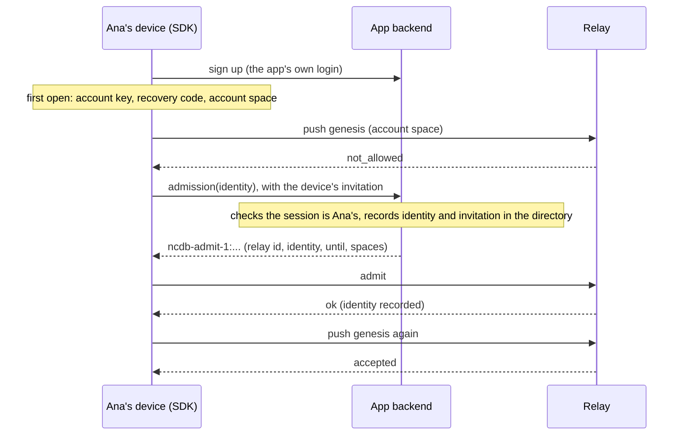
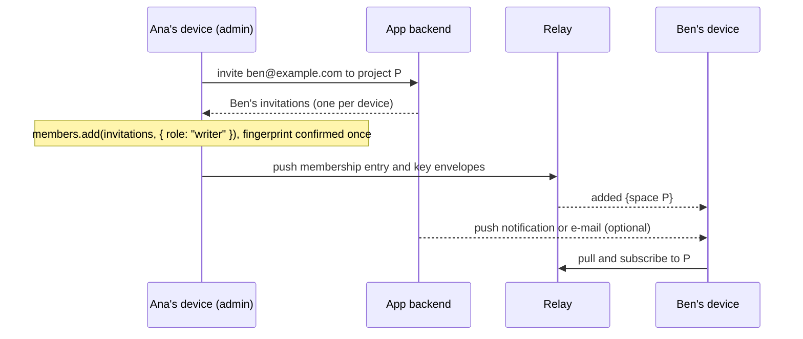
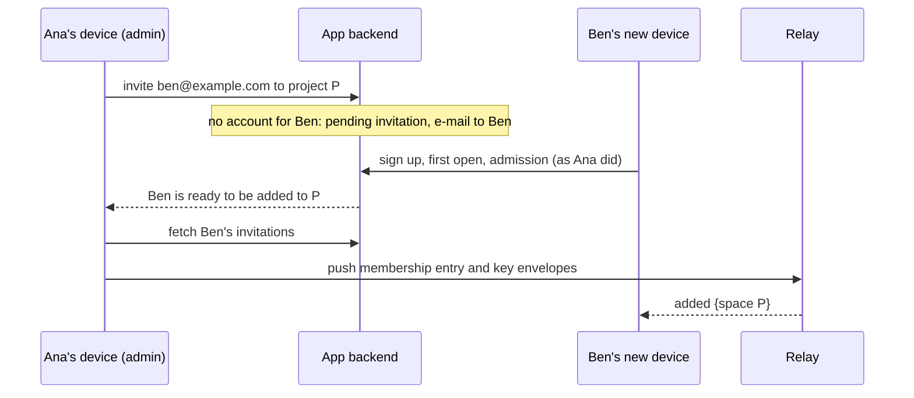

# RFC 0015: Who may create spaces on a relay, without a redeploy

REQUEST FOR COMMENTS · NOVEMBER 2026 · Ticket NOC-413

This RFC defines how a relay admits an account that may create spaces, so that an app with open signup can use a relay without listing every account when the relay is deployed. It keys admission by the account's identity, which survives a recovery and a lost device; it lets the app's backend admit its own users with a signed admission token; it sets a ceiling on what the project's own relay may cost; and it follows one user through an app, from signup to working with others, to show developers how to cut their data into spaces.

It builds on [RFC 0007](0007-relay.md), which defines the relay, who may create a space and what the relay costs, and on [RFC 0010](0010-accounts.md), which makes the recovery key the account's identity; [How this RFC relates to the others](#how-this-rfc-relates-to-the-others) names the rest.

**How to give feedback.** Start a discussion in the category [RFC feedback](https://github.com/nocentraldb/nocentraldb/discussions/categories/rfc-feedback), naming RFC 0015 and the section you mean, or open a pull request against this file to change its text. [Giving feedback](README.md#giving-feedback) says how, and what happens to your point.

**Status.** Decided. The owner decided this RFC as it stands (Carsten, 2026-11-22). Admission by identity is built: the relay admits an account by its identity, and RFC 0007 says so (NOC-420). The relay takes admission tokens with `admit`, and RFC 0007 says so (NOC-469); the SDK's `admission` option and `db.account.identity`, the ceiling on spend and the quotas are not built; their [follow-up tickets](#follow-up-tickets) build them and rewrite RFC 0009 for them.

**At 0.1.** Not built. Release 0.1 admits the accounts in `NCDB_ALLOWED_ACCOUNTS` by their account key, so a listed account that recovers or answers a lost device is refused with `not_allowed` until the operator lists its new key; NOC-420 fixes that first.

**Out of scope.** Who may write into a space that exists: membership decides that ([RFC 0008](0008-membership.md)), and nothing here changes it. Quotas on stored bytes and on writes per member are named under [Abuse and cost](#abuse-and-cost), but their design is a follow-up of its own.

## Summary

| Question | Answer |
| --- | --- |
| By what does the relay admit an account? | By its identity: the recovery key that the certificate's account key statement names, and the account key only for an account whose certificates carry no statement. A recovery or a lost device leaves the identity as it is. |
| How does a new account get admitted without a redeploy? | With an **admission token**: the app's backend signs it with an admission key whose public half the operator configures on the relay, once per app. The member presents it once, and the relay records the identity. |
| What does the developer do? | Passes a function to `nc.open` that fetches an admission from the app's backend. The SDK calls it when the relay refuses a new space, and the developer handles a string, never a key. |
| How long does an admission last? | Until a time the app chooses. The SDK fetches a new one through the same function, so an app withdraws an account by no longer issuing admissions. |
| What does it cost? | One small item per admitted account and one read on each genesis: below a cent a month for 10,000 accounts. |
| What limits abuse? | The app's signup bounds who is admitted; each admission bounds the spaces of its identity; throttling holds the project's own relay under 20 USD a month. Quotas on writes are a follow-up. |
| How should an app cut its spaces? | By who reads: a personal space per user, a space per project, a space per note shared on its own ([How to cut spaces](#how-to-cut-spaces)). |

## The account's identity

The relay admits a genesis when the account that certified its creator may create spaces ([RFC 0007, "What the relay checks"](0007-relay.md#what-the-relay-checks), "Who may create a space"). It recognises that account by its **identity**: the recovery key that the account key statement in the creator's certificate names ([RFC 0010, "The account's identity"](0010-accounts.md#the-accounts-identity)). An entry of `NCDB_ALLOWED_ACCOUNTS`, an admission and the record of a guest's one space are all keyed by it.

The identity is what stays when the account key changes. RFC 0010 answers two events with a new account key under the same recovery key: **recovering** on a new device from the recovery code, after every device is lost ([RFC 0010, "The recovery code"](0010-accounts.md#the-recovery-code)), and **losing a device**, through `db.account.removeMember(memberId, { recover })` on a remaining device ([RFC 0010, "Losing a device"](0010-accounts.md#losing-a-device)). Afterwards every device of the account holds a certificate for the new key, and the relay still recognises the account.

The relay reads the identity from what it already receives. The certificate in a genesis carries the account key statement as its key 6, and `Certificate::verify` checks that the statement names the certificate's account key and verifies under its recovery key, so no new message and no change to any format is needed. A thief who holds an old device cannot forge a statement for a recovery key it does not hold.

**A lost device keeps its old certificate**, which names the same recovery key with a lower number. The relay therefore keeps, per identity, the highest statement number it has seen in a genesis, an add or an account key statement entry, and refuses a genesis whose statement carries a lower number, as RFC 0008's fold refuses a superseded account key ([RFC 0008, "Account key statement entry"](0008-membership.md#account-key-statement-entry)). Until the relay has seen the newer statement, a lost device can still create spaces in the account's name.

**An account without a statement**, one a database drew before RFC 0010 was built, has no recovery key. Its identity is its account key, as its fingerprint is ([RFC 0010, "The fingerprint"](0010-accounts.md#the-fingerprint)). When the SDK upgrades it, statement 1 names that same key, so a list entry that holds the account key keeps matching it until the account's first recovery. Operators list recovery keys from then on; the deploy guide prints the recovery key of an invitation.

**Options not taken.** Keying admission by the account key, as 0.1 does: every recovered account and every account that lost a device would be refused until the operator listed its new key, and a guest would get a fresh one-space allowance with each new key.

## Admission tokens

An app with open signup cannot list its users when the relay is deployed. Its backend already knows them, so the backend admits them. It signs an **admission** for an account's identity with an **admission key**, an Ed25519 key that only the backend holds. The operator configures the public half of each app's admission key on the relay, in `NCDB_ADMISSION_KEYS`, as it configures the allowlist: once per app, not once per account.

### The admission

An admission is a canonical CBOR map, signed under the context string `"nocentraldb/relay-admission"` by RFC 0003's rule for every signed input ([RFC 0003, "Formats of what keys sign and derive"](0003-keys-and-cryptography.md#formats-of-what-keys-sign-and-derive)):

```text
admission
├── 1 relay id     the relay it admits to, so it is worth nothing on another
├── 2 identity     32 bytes: the recovery key, or the account key of an account without one
├── 3 until        Unix seconds: the admission lapses then
├── 4 spaces       how many spaces the identity may create on this relay
└── 5 signature    64 bytes, by the admission key, over keys 1 to 4
```

As text it is `ncdb-admit-1:` and unpadded base64url, like the invitation and the pairing answer ([RFC 0010, "The pairing answer"](0010-accounts.md#the-pairing-answer)).

`docs/rfc/vectors/0015/` holds two admissions, of an identity that is a recovery key and of one that is an account key, as text and as bytes, with their inputs and the hash the admission key signs in `fields.txt`. `generate.py` writes them with independent libraries; the core and `scripts/rfc-0015-admission.test.mjs` check them.

An admission need not prove that its presenter holds the identity: it admits only geneses whose certificate names that identity, so a stolen admission gives its thief nothing.

### How the relay takes it

A member presents an admission with a new request, `admit`, after `auth`. The relay checks the signature against its configured keys, its own relay id and the time, and records the identity with `until`, `spaces`, the admission key and a count of the spaces created. A genesis is accepted when its certificate's identity is on the allowlist, or holds an admission that has not lapsed and whose count is below `spaces`. The count rises as an effect of the genesis append, exactly as a guest's one space is recorded ([RFC 0007, "The backend interface"](0007-relay.md#the-backend-interface)), so two devices of one account that push at once cannot exceed it. A later admission for the same identity replaces the earlier one: the app renews an admission, or raises its spaces, by issuing a new one.

An admission gates only the creation of spaces. When it lapses, the identity's spaces keep working, and its devices keep reading and writing in every space they belong to.

### In the SDK

The app passes a function that fetches an admission from its backend:

```ts
const db = await nc.open({
  model, lock, relay,
  admission: (identity) => fetch("/api/ncdb-admission", { method: "POST", body: identity }).then((r) => r.text()),
});
db.account.identity; // the recovery key in hexadecimal, public
```

The SDK calls the function when the relay answers a genesis with `not_allowed`, presents the answer with `admit`, and pushes the genesis again, once. The backend authenticates its user, then signs the identity it was given. The developer handles a string from its own backend, never a key ([GENESIS.md, principle 5](../../factory/GENESIS.md#principles-in-priority-order)). An app may also call the function right after the first open, so that its backend learns the identity before anyone looks for the user.

**An admission lapses at a time the app chooses.** The SDK fetches a new one through the same function when the relay refuses a genesis again, so an app withdraws an account by no longer issuing admissions, without asking the operator. Withdrawing one at once needs the operator to delete its record.

### What it does not do

- **It does not decide who the user is.** The app's signup does, with whatever the app uses against fake accounts: e-mail checks, captchas, payment. An app that admits everyone opens the relay to everyone.
- **A leaked admission key** lets its thief admit any identity on that relay until the operator removes the key. The relay names the key in each record, so the operator can find and delete what it admitted.
- **It limits spaces, not writes.** An admitted identity can write as fast as its connection allows in every space it belongs to ([Abuse and cost](#abuse-and-cost)).

### Options not taken

- **A list the app's backend updates at runtime, through a privileged endpoint on the relay.** An HTTP API next to the WebSocket API, authenticated with AWS IAM on AWS or a shared secret on the other backends, would let the app's backend add and remove identities, and the SDK would change nothing. It gives the same trust as an admission token, but the relay gains a privileged endpoint reachable from the internet, each backend authenticates it differently though every check is meant to live in one relay core, and every app's backend holds a credential for the relay, scoped so that one app cannot remove another app's accounts.
- **Open signup with a rate limit.** Anybody who reaches the relay may create spaces, limited per account, per network address, or globally. An account costs nothing to draw, so a limit per account limits nothing; a limit per network address catches one machine, not a botnet, and hits honest users behind one carrier NAT; a global limit turns abuse into a denial of service for every app on the relay. RFC 0007 turned down "anyone who can reach the relay" for the same reason: "a relay must not become free storage for strangers and a bill for its operator". On AWS, a change of up to 8 KiB stored inline costs about 22 write units in its transaction, so about 16 USD per million pushes with the API Gateway messages, and its storage stays: 8 GB a month per million such changes ([RFC 0007, "What it costs"](0007-relay.md#what-it-costs)). One connection pushing 50 changes a second costs about 70 USD a day; at API Gateway's default account limit of 10,000 requests a second, roughly 14,000 USD a day. These are estimates from list prices, as in RFC 0007.
- **The static list alone**, keyed by identity: the operator would still redeploy for every new account.

## Abuse and cost

Admissions cost one DynamoDB item of about 100 bytes per admitted identity and one read on each genesis, which already reads: below a cent a month for 10,000 accounts. Verifying a signature costs microseconds of Lambda.

Admission decides **who** may create spaces, not **how much** anybody writes. At 0.1 nothing limits writes on any relay: `rate_limited` is reserved in RFC 0007's errors, but no code sends it, and the AWS stack sets no throttling. Any member of any space can push changes as fast as its connection allows. With a fixed list of the operator's own accounts that risk was small; with open signup, every user of an app holds such an account. Two limits therefore come before an app opens signup on a relay the project pays for:

- **A ceiling on spend.** API Gateway stage throttling and reserved concurrency on the function hold the project's own relay under **20 USD a month**, its budget today. It caps the worst case, at the price of `unavailable` for everybody once reached. Other operators size their own.
- **Quotas per identity and per member.** The admission's `spaces` bounds each identity's spaces. Stored bytes and changes per minute per member, answered with `rate_limited`, are a design of their own. A counter per member in the push's transaction costs two more write units per push, a quarter of a small push's write cost, unless it is kept per connection and written less often.

**Options not taken.** No ceiling, with the budget only sending a mail: one abusive account could run up thousands of dollars before anyone read the mail.

## A user's journey

This section follows one user of a notes and projects app with open signup, from signup to working with others. It uses invitations as [RFC 0009, "Invitations and members"](0009-sdk-api.md#invitations-and-members) defines them and accounts as [RFC 0010](0010-accounts.md) defines them. Two things set the shape of every step:

- **An invitation flows from the joining member to an admin, not the other way.** It is the joining member's public identity: its member id, public keys and certificate. An admin adds a member only with that member's invitation. So "Ana invites Ben" means that Ben's devices have sent their invitations somewhere Ana's device can fetch them, and that a device of Ana's, an admin of the space, writes the add.
- **The app's backend already knows its users.** It is where an account's identity meets the app's user: the backend signs the admission for that identity. The same step records the user's identity and their devices' invitations in the backend's **directory**, which maps an app user, such as an e-mail address, to an identity and its invitations. Nothing in the directory is secret: identities and invitations are public, and the relay sees them anyway.

### Becoming a user

Ana signs up in the app, with whatever the app uses: an e-mail address and a password, a passkey, a login with another service. NoCentralDB plays no part in this. Then the app opens a database on her device. The first open of a database that is neither paired nor recovered creates an account ([RFC 0010, "The account key and where it lives"](0010-accounts.md#the-account-key-and-where-it-lives)): it draws the account key and the recovery code, and the app shows the twelve words once. The first space the SDK pushes is the account space ([RFC 0010, "The account space"](0010-accounts.md#the-account-space)). The relay does not know Ana's identity yet and answers `not_allowed`. The SDK calls the app's `admission` function with Ana's identity. The app's backend checks that the caller is Ana, signs the admission, and stores Ana's identity and her device's invitation in its directory. The SDK presents the admission with `admit` and pushes the account space again.



Ana's later devices join her account by pairing ([RFC 0010, "Adding a device or an agent to an account"](0010-accounts.md#adding-a-device-or-an-agent-to-an-account)). They need no admission of their own, because the relay admits the identity, not the device. Each new device's invitation goes to the directory as well, so that others can add it. A user whose device is offline at signup works on: spaces are created locally, and admission and the first pushes happen at the next connection.

### Her first notes and her first project

The app creates a **personal space** for Ana on her first device: `db.spaces.create()`, and in it an object of the app's own model, for example a `notebooks` object that says this is Ana's personal space. A space has no name in the SDK; names live in the app's model ([RFC 0009, "Spaces"](0009-sdk-api.md#spaces)). Her private notes go there. Each of her devices is a member, because pairing adds a new device to every space where a device of the account is an admin.

When Ana creates a project, the app creates a **project space** and writes the project's object into it, with its name. The project's tasks and notes go into the same space, so the whole project shares one membership.

The personal space is not the account space. The account space holds what the SDK needs, in the SDK's own model, and an app cannot write into it.

### Inviting someone

Ana invites Ben by his e-mail address, to the project or to a single note.

- **To a project.** Ana's device asks the directory for Ben's invitations, one per device of his account, and calls `project.members.add(invitations, { role })`. The relay tells each of Ben's connected devices with `added` ([RFC 0007, "Subscribe: follow a space live"](0007-relay.md#subscribe-follow-a-space-live)), and his app shows the project through `db.spaces.subscribe`. Ben's agents are not in the list: an agent gets the spaces its task needs, and Ben adds it himself.
- **To a single note.** A note lives in exactly one space, and membership is per space, so Ben cannot be given one note of a project or of Ana's personal space alone. The note moves into a space of its own first. Moving an object between spaces is designed in an RFC of its own, with the notice RFC 0003 says comes later; until it is built, the app copies the note into a new space and deletes the original, and the copy has a new id and history. An app that expects notes to be shared alone creates each such note in its own space from the start. The project keeps a reference to it with `nc.ref` ([RFC 0004, "References"](0004-merge-rules-basic-types.md#references)); a project member who is not a member of the note's space reads that reference as `notAccessible`.

**Ana's device confirms Ben's account once.** Ben's account is new to her device, so `members.add` fails with `unknownAccount` until the app passes the account's fingerprint ([RFC 0009, "Invitations and members"](0009-sdk-api.md#invitations-and-members)). A messaging app has two people compare safety numbers. An app with a directory may instead pass the fingerprint its directory reports, as its own choice. Then the app's backend decides who Ben is, and a backend that swaps Ben's invitation for one of its own adds a reader nobody chose. `members.add` therefore returns a notice that says the directory vouched for the account, and the app offers a screen where people compare fingerprints later.

### How Ben learns of it, and what happens next

**Ben already has an account.** His invitations are in the directory, so Ana's device adds him at once. If one of his devices is connected, the relay's `added` reaches it within a second, and the app shows the shared project. A device that is offline learns it at its next connection, when the relay names the space in `welcome`. The app's backend can also send Ben an e-mail or a push notification; it knows of the invitation because Ana's app asked it for Ben's invitations, and it learns no content.



**Ben has no account yet.** Nobody can add him: a member is a key pair on his device, and it does not exist yet. The invitation is a promise the app keeps, not a change in any space:

1. Ana invites ben@example.com. The app's backend stores a pending invitation, project P with role writer, and sends Ben an e-mail with a link to the app.
2. Ben signs up and opens the app. His device creates his account, and his admission puts his identity and invitation in the directory, as in [Becoming a user](#becoming-a-user).
3. The backend tells Ana's devices that the pending invitation can now be carried out, by a push notification or on their next connection to the backend.
4. A device of Ana's, or of any admin of P, fetches Ben's invitation and adds him. Ben's device learns it through `added`.



Between steps 2 and 4, Ben has signed up but sees nothing of P, until a device of an admin of P runs. That gap is the price of an invitation that flows from the joining member: no server may write an add, because it would hold the space key. The SDK does not close the gap itself. An app may run an admin agent of the inviter's account in the cloud, as a visible member of P, that carries out pending invitations while Ana's devices are off. The pending invitation tells the backend who was invited to which project, which the relay never learns; the backend knows it already as the app's own data.

**Ben's next device.** When Ben pairs a second device, his SDK adds it to the spaces where his account holds an admin. In P he is a writer, so his SDK lists P among the spaces whose admins the app asks, and the app asks Ana's device, through the backend, to add the new invitation. Her SDK accepts it without a fingerprint, because Ben's account is known to it ([RFC 0010, "Adding a device or an agent to an account"](0010-accounts.md#adding-a-device-or-an-agent-to-an-account)).

**Options not taken.** Requiring a person to compare every new account's fingerprint: an app with open signup cannot make every pair of users compare 60 digits before they work together. An admin agent that the SDK runs for every app, to carry out pending invitations: it would be a member in every app's spaces that no app chose.

## How to cut spaces

The journey gives the rule: **a space holds the objects that the same members read**. Cut by who reads, not by object type.

| Space | Members | Holds | When |
| --- | --- | --- | --- |
| Personal space | The user's own devices | The user's private notes, settings and drafts | One per user, made at the first open |
| Project space | The project's members, with roles | The project's object and name, its tasks and notes | One per project |
| Shared-note space | The people the note is shared with | One note, or a small set shared with the same people | Once a note is shared on its own, or from its creation if the app expects that |
| Account space | The user's devices, all admins | What the SDK needs; the app does not write here | Made by the SDK |
| Ad-hoc space | An agent and its sub-agent | What one task needs ([RFC 0009, "Sub-agents and ad-hoc spaces"](0009-sdk-api.md#sub-agents-and-ad-hoc-spaces)) | Per task |

- **Not too coarse.** One space for all of an app's data gives every member every object; a space for a whole team makes every team member a reader of every project. Fine-grained rights come only from small spaces (GENESIS.md).
- **Not too fine.** Each space costs work on every change of membership: adding a person writes an entry and an envelope in each space, and removing one rotates the key of each space, on the admin's device. A space per task in a project of 300 tasks makes adding a member 300 adds. Split a space when the readers differ, not when the objects do.
- **Across spaces, use references.** A link points only into its own space; `nc.ref` points into another, and reads as `notAccessible` for a member who is not in the target's space ([RFC 0004, "References"](0004-merge-rules-basic-types.md#references)). A project lists its shared notes by reference.
- **Plan for sharing.** Until moving an object between spaces is built, an object that will be shared with other people than its neighbours starts in its own space.
- **Count spaces for admission.** The `spaces` an admission grants covers the personal space, the account space and every project and shared note the user will create. The relay cannot tell them apart.

## Follow-up tickets

This RFC changes no other RFC and no code. These tickets build it:

- **NOC-420, admission by identity:** `check_genesis` and the guest's one space key by the recovery key, with the highest statement number kept per identity; RFC 0007's "Who may create a space" and its AWS table rewritten; `docs/relay-deploy.md` prints the recovery key; a relay test shows that a listed account still creates spaces after recovering.
- **Admission tokens:** the format and its test vectors in RFC 0003's style; the `admit` request and its errors in RFC 0007; `NCDB_ADMISSION_KEYS` in the Lambda settings and the CDK stack; the store item on all backends with its conformance tests; the `admission` option and `db.account.identity` in both SDKs and RFC 0009.
- **A ceiling on spend:** throttling and reserved concurrency in `infra/aws`, sized to hold the project's relay under 20 USD a month.
- **Quotas:** a short design for stored bytes and changes per minute per member, answered with `rate_limited`, then its build.
- **The directory's notice:** the notice `members.add` returns when an app passes a fingerprint its directory reported, in RFC 0009 and both SDKs.
- **Moving an object between spaces:** an RFC of its own, with its notice.
- **A guide for developers:** how to cut spaces and how invitations flow through an app's backend, from [A user's journey](#a-users-journey) and [How to cut spaces](#how-to-cut-spaces), with an example backend in `apps/` that issues admissions and keeps a directory.

## How this RFC relates to the others

It changes who may create a space in [RFC 0007](0007-relay.md#what-the-relay-checks), reads the account's identity as [RFC 0010](0010-accounts.md#the-accounts-identity) defines it and the certificate and its statement as [RFC 0003](0003-keys-and-cryptography.md) and [RFC 0008](0008-membership.md) define them, adds an option and a name to [RFC 0009](0009-sdk-api.md), and follows RFC 0009's invitations and [RFC 0004](0004-merge-rules-basic-types.md)'s references in its user journey. It follows the principles in [GENESIS.md](../../factory/GENESIS.md): the relay still holds no key that reads content, and the developer handles a string, never a key.

## History

- 2026-11-22 · First published (NOC-413, #423)
