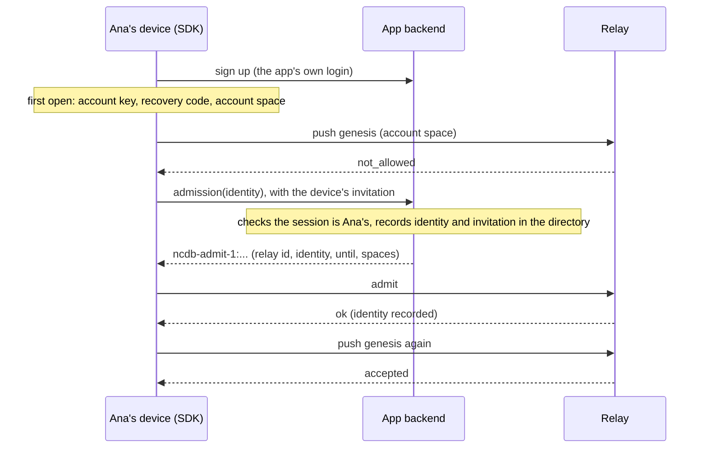
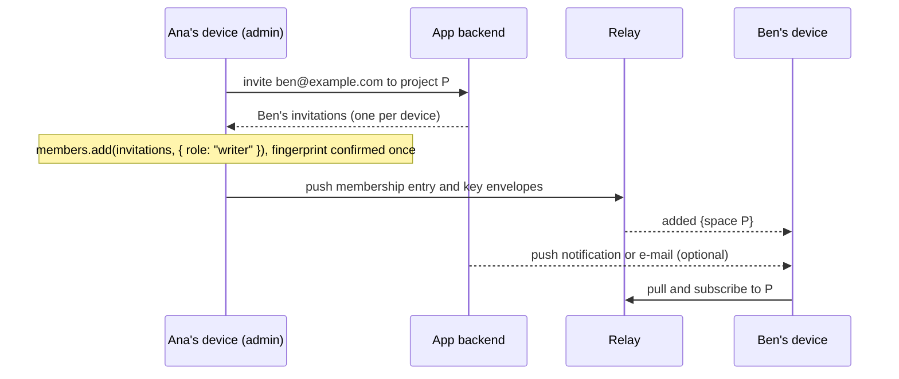
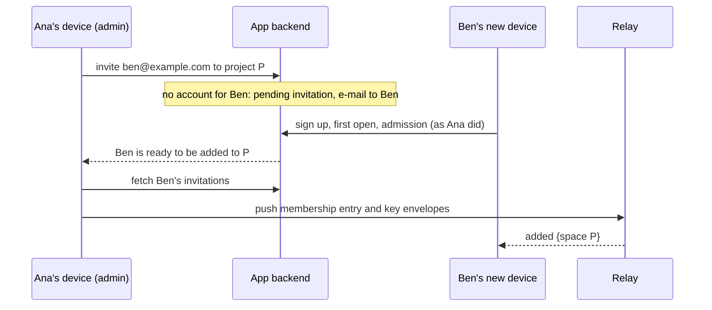

# RFC 0015: Who may create spaces on a relay, without a redeploy

REQUEST FOR COMMENTS · NOVEMBER 2026 · Ticket NOC-413

This RFC decides how a relay admits a new account, so that an app with open signup can use a relay without listing every account at deploy time. Today the relay accepts a genesis only from an account on the operator's allowlist, `NCDB_ALLOWED_ACCOUNTS`, plus one account space for each guest ([RFC 0007, "What the relay checks"](0007-relay.md#what-the-relay-checks), "Who may create a space"). The list is fixed when the relay is deployed, and it holds account keys. It also fixes a bug that list has today: an account that recovers, or answers a lost device, gets a new account key ([RFC 0010, "The recovery code"](0010-accounts.md#the-recovery-code)), and the relay then refuses every space it creates.

It builds on [RFC 0007](0007-relay.md), which defines the relay and its costs, and on [RFC 0010](0010-accounts.md), which makes the recovery key the account's identity; [How this RFC relates to the others](#how-this-rfc-relates-to-the-others) names the rest.

**How to give feedback.** Start a discussion in the category [RFC feedback](https://github.com/nocentraldb/nocentraldb/discussions/categories/rfc-feedback), naming RFC 0015 and the section you mean, or open a pull request against this file to change its text. [Giving feedback](README.md#giving-feedback) says how, and what happens to your point.

**Status.** Decided by the owner (Carsten, 2026-11-22), on NOC-429: the relay admits by the account's identity, open signup goes through an admission token from the app's backend (option C), and the answers in [What the owner decided](#what-the-owner-decided). Nothing of it is built. RFC 0007 and RFC 0009 still describe the static allowlist; the [follow-up tickets](#follow-up-tickets) rewrite them and build the chosen design.

**At 0.1.** Not built. Release 0.1 keeps RFC 0007's static allowlist of account keys.

**Out of scope.** Who may write into a space that exists: membership decides that ([RFC 0008](0008-membership.md)), and nothing here changes it. Quotas on writes are named under [Abuse and cost](#abuse-and-cost), because every option needs them, but their design is a follow-up of its own.

## Summary

| Question | Answer |
| --- | --- |
| Is the recovery bug real? | Yes. The relay compares the genesis certificate's account key with the list (`Relay::check_genesis`). Recovery from the code and `removeMember` both draw a new account key under the same recovery key, so the account's devices are refused with `not_allowed`. NOC-420 fixes it, with a test that shows it. |
| What should the relay key admission by? | The account's identity: the recovery key that the certificate's account key statement names, and the account key only for an account whose certificates carry no statement. The relay already receives the statement in every genesis, and can verify it. |
| How does a new account get admitted without a redeploy? | Decided (Carsten, 2026-11-22, NOC-429): an **admission token**, signed by the app's backend with an admission key whose public half the operator configures on the relay. The member presents it once; the relay records the identity at runtime. |
| What does that cost? | One small item per admitted account, and one read on each genesis: below a cent a month for thousands of accounts. |
| What does it mean for an app? | [A user's journey](#a-users-journey) follows a user from signup to inviting others, with and without an account, and [How to cut spaces](#how-to-cut-spaces) derives where an app puts its objects: a personal space, a space per project, a space per note shared on its own. |
| What does it not solve? | How much an admitted account writes. Today nothing limits that on any relay. Open signup makes the gap larger, so quotas and a hard ceiling on spend are follow-ups whatever the owner chooses. |

## The recovery bug

`NCDB_ALLOWED_ACCOUNTS` holds 32-byte account keys ([Deploying the relay to AWS](../relay-deploy.md)), and `Relay::check_genesis` admits a genesis when `allowed_accounts` contains `genesis.certificate.account_key`. RFC 0010 makes the recovery key, not the account key, the account's identity ([RFC 0010, "The account's identity"](0010-accounts.md#the-accounts-identity)), and answers two events with a new account key under the same recovery key:

- **Recovering** on a new device from the recovery code, after every device is lost.
- **Losing a device**, through `db.account.removeMember(memberId, { recover })` on a remaining device ([RFC 0010, "Losing a device"](0010-accounts.md#losing-a-device)).

After either, every device of the account holds a certificate for a key that is not on the list, and every genesis it pushes is refused with `not_allowed`. The guest rule does not help: a recovered device is a member of nothing until somebody adds it again, and the record of a guest's one space is keyed by the account key too, so the same flaw runs the other way: each new account key of a guest gets a fresh one-space allowance.

The certificate in a genesis carries the account key statement as its key 6, and `Certificate::verify` checks that the statement names the certificate's account key and verifies under its recovery key. The relay can therefore read the identity from what it already receives, without a new message and without a change to any format. A thief who holds an old device cannot forge a statement for a recovery key it does not hold.

Keyed by identity, one question appears that the account key hid: **a lost device keeps its old certificate**, which names the same recovery key with a lower number. The relay therefore keeps, per identity, the highest statement number it has seen in a genesis, an add or an account key statement entry, and refuses a genesis whose statement carries a lower number, as RFC 0008's fold refuses a superseded account key ([RFC 0008, "Account key statement entry"](0008-membership.md#account-key-statement-entry)). Until the relay has seen the newer statement, a lost device can still create spaces; with the list keyed by account key, it can do so until the operator removes its key, which nobody does without knowing which key the device held.

An account whose certificates carry no statement, one a database drew before RFC 0010 was built, has no recovery key. Its identity is its account key, as the fingerprint already does for such an account ([RFC 0010, "The fingerprint"](0010-accounts.md#the-fingerprint)). When the SDK upgrades it, statement 1 names that same key, so a list entry that holds the account key keeps matching it until its first recovery.

This fix is independent of open signup and is its own ticket, NOC-420 (Carsten, 2026-11-22, NOC-429). Every option below assumes it.

## The options

### A. The static list, keyed by identity

The fix above, and nothing more: the operator lists recovery keys, and still redeploys to add one. It does not serve an app with open signup, which is what the ticket asks for. It is the right fix now, and the base of every other option.

### B. A list the operator or the app's backend updates at runtime (not taken)

The relay keeps the admitted identities in its store instead of its settings. A privileged endpoint adds and removes them: an HTTP API next to the WebSocket API, authenticated with AWS IAM (SigV4) on AWS or a shared secret on the other backends, which the app's backend calls when a user signs up.

- **For:** the member and the SDK change nothing; removing an identity takes effect at once.
- **Against:** the relay gains a privileged endpoint reachable from the internet, and each backend authenticates it differently, though all checks are meant to live in one relay core ([RFC 0007, "The backend interface"](0007-relay.md#the-backend-interface)). The app's backend holds a credential for the relay and must reach it at signup. For the operator of a public relay, every app it serves needs a credential of its own, scoped so that one app cannot remove another app's accounts.
- **Abuse:** bounded by the app's signup, as for C.
- **Cost:** an API Gateway HTTP API at 1 USD per million calls and one DynamoDB write per signup: negligible.

### C. An admission token from the app's backend (chosen)

The app's backend, which already knows its users, signs an **admission** for an account's identity with an **admission key**, an Ed25519 key that only the backend holds. The operator configures the public half of each app's admission key on the relay, `NCDB_ADMISSION_KEYS`, as it configures the list today: once per app, not once per account.

The admission is a canonical CBOR map, signed under the context string `"nocentraldb/relay-admission"` by RFC 0003's rule for every signed input ([RFC 0003, "Formats of what keys sign and derive"](0003-keys-and-cryptography.md#formats-of-what-keys-sign-and-derive)):

```text
admission
├── 1 relay id     the relay it admits to, so it is worth nothing on another
├── 2 identity     32 bytes: the recovery key, or the account key of an account without one
├── 3 until        Unix seconds: the admission lapses then
├── 4 spaces       how many spaces the identity may create on this relay
└── 5 signature    64 bytes, by the admission key, over keys 1 to 4
```

As text it is `ncdb-admit-1:` and unpadded base64url, like the invitation and the pairing answer ([RFC 0010, "The pairing answer"](0010-accounts.md#the-pairing-answer)).

A member presents it with a new request, `admit`, after `auth`. The relay checks the signature against its configured keys, its own relay id and the time, and records the identity with `until`, `spaces`, the admission key and a count of the spaces created. A genesis is then accepted when its certificate's identity is on the static list, or holds an admission that has not lapsed and whose count is below `spaces`; the count rises as an effect of the genesis append, exactly as a guest's one space does today ([RFC 0007, "The backend interface"](0007-relay.md#the-backend-interface)). A later admission for the same identity replaces the earlier one, so the app renews or raises it by issuing a new one.

The token need not prove that its presenter holds the identity: it admits only geneses whose certificate names that identity, so a stolen token gives its thief nothing.

In the SDK, the app passes a function that fetches an admission from its backend: `nc.open({ ..., admission: (identity) => fetch(...) })`. The SDK calls it when the relay answers a genesis with `not_allowed`, presents the answer with `admit`, and pushes the genesis again, once. The developer handles a string from its own backend, never a key (principle 5). The backend authenticates its user, then signs `identity`; the SDK names it `db.account.identity`, the recovery key in hexadecimal.

- **For:** the relay holds no secret and offers no privileged endpoint; the relay core checks the admission the same way on every backend; the app's backend never needs to reach the relay; a public relay can serve many apps, each with its own key, and none can touch another's accounts.
- **Against:** a new request and a new signed format, which are the owner's to decide (GENESIS.md, "What has to come back through me") and which the owner decided with this RFC; an SDK option and a public name; withdrawing an admission at once needs the operator to delete its record, otherwise it lapses at `until`. Existing spaces of a lapsed identity keep working, because admission gates only the creation of spaces.
- **Abuse:** bounded by the app's signup, which is where an app already fights fake accounts with e-mail checks, captchas or payment. `spaces` bounds each identity's spaces. A leaked admission key lets its thief admit any identity on that relay until the operator removes the key; the relay names the key in each record, so the operator can also find and delete what it admitted.
- **Cost:** one DynamoDB item of about 100 bytes per admitted identity and one read on each genesis, which already reads: below a cent a month for 10,000 accounts. Verifying a signature costs microseconds of Lambda.

### D. Open signup with a rate limit (not taken)

Anybody who reaches the relay may create spaces, limited per account, per network address, or globally.

- **For:** no work for the app, no new request.
- **Against:** an account costs nothing to draw, so a limit per account limits nothing. A limit per network address catches one machine, not a botnet or a block of cloud addresses, and hits honest users behind one carrier NAT. A global limit turns abuse into a denial of service for every honest app on the relay. RFC 0007 already turned down "anyone who can reach the relay", because "a relay must not become free storage for strangers and a bill for its operator".
- **Abuse and cost:** unbounded except by the global limit. On AWS, a change of up to 8 KiB stored inline costs about 22 write units in its transaction, so about 16 USD per million pushes with the API Gateway messages, and its storage stays: 8 GB a month per million such changes, 2 USD for every month it is kept ([RFC 0007, "What it costs"](0007-relay.md#what-it-costs)). One connection pushing 50 changes a second costs about 70 USD a day and adds 35 GB of storage a day. At API Gateway's default account limit of 10,000 requests a second, the bill could reach roughly 14,000 USD a day. These are estimates from list prices, as in RFC 0007.

## Abuse and cost

| | A. Static, by identity | B. Runtime list | C. Admission token | D. Open signup |
| --- | --- | --- | --- | --- |
| Serves open signup | No | Yes | Yes | Yes |
| Who decides who may create spaces | The operator | The app's backend, with a relay credential | The app's backend, with its admission key | Anybody |
| New on the relay | Nothing | A privileged endpoint and its credentials | A request, a format, a store item | Limits |
| Sybil accounts | Impossible | Bounded by the app's signup | Bounded by the app's signup | Unbounded |
| Added AWS cost | None | About 0 | About 0 | Unbounded but for a global limit |
| Same on every backend | Yes | No: IAM on AWS, a secret elsewhere | Yes | Yes |

Admission decides **who** may create spaces, not **how much** anybody writes. Today nothing limits writes on any relay: `rate_limited` is reserved in RFC 0007's errors, but no code sends it; the AWS stack sets no API Gateway throttling and no reserved concurrency on the function; and the 20 USD budget only sends a mail. Any member of any space, a guest in its account space included, can push changes as fast as its connection allows, at the costs in option D. With a fixed list of the operator's own accounts that risk was small. With open signup, every user of the app holds such an account. So, whichever option is chosen:

- **A ceiling on spend**: API Gateway stage throttling and reserved concurrency on the function, sized so that the relay at full use stays under a monthly cost the owner sets. It caps the worst case, at the price of `unavailable` for everybody once reached.
- **Quotas per identity and per member**: a number of spaces (C carries it in the admission), stored bytes, and changes per minute, answered with `rate_limited`. A counter per member in the push's transaction costs two more write units per push, a quarter of a small push's write cost, unless it is kept per connection and written less often.

Both are follow-ups with their own design; a write to AWS and a larger bill wait for the owner.

## A user's journey

This section follows one user of an app with open signup, a notes and projects app, from signup to working with others. It assumes option C. It uses invitations as [RFC 0009, "Invitations and members"](0009-sdk-api.md#invitations-and-members) decided them and accounts as [RFC 0010](0010-accounts.md) decided them. Where those RFCs left a step open, the step says so and [What the owner decided](#what-the-owner-decided) records the answer. Two things set the shape of every step:

- **An invitation flows from the joining member to an admin, not the other way.** It is the joining member's public identity: its member id, public keys and certificate. An admin adds a member only with that member's invitation. So "Alice invites Bob" means that Bob's devices must have sent their invitations somewhere Alice's device can fetch them, and that a device of Alice's, an admin of the space, writes the add.
- **The app's backend already knows its users.** Under option C, it is also where an account's identity meets the app's user: the backend signs the admission for that identity. The same step can record the user's identity and their devices' invitations in the backend's **directory**, which maps an app user, such as an e-mail address, to an identity and its invitations. Nothing in the directory is secret: identities and invitations are public, and the relay already sees them.

### Becoming a user

Ana signs up in the app, with whatever the app uses: an e-mail address and a password, a passkey, a login with another service. NoCentralDB plays no part in this. Then the app opens a database on her device. The first open of a database that is neither paired nor recovered creates an account ([RFC 0010, "The account key and where it lives"](0010-accounts.md#the-account-key-and-where-it-lives)): it draws the account key and the recovery code, and the app shows the twelve words once. The first space the SDK pushes is the account space ([RFC 0010, "The account space"](0010-accounts.md#the-account-space)). The relay does not know Ana's identity yet and answers `not_allowed`. The SDK calls the app's `admission` function with Ana's identity. The app's backend checks that the caller is Ana, signs the admission, and stores Ana's identity and her device's invitation in its directory. The SDK presents the admission with `admit` and pushes the account space again.



Ana's later devices join her account by pairing ([RFC 0010, "Adding a device or an agent to an account"](0010-accounts.md#adding-a-device-or-an-agent-to-an-account)). They need no admission of their own, because the relay admits the identity, not the device. Each new device's invitation goes to the directory as well, so that others can add it.

An app that calls the admission function only on `not_allowed` learns the identity late; it can call it right after the first open instead, so that the directory holds Ana before anyone looks for her. The SDK can offer both. A user whose device is offline at signup works on: spaces are created locally, and admission and the first pushes happen at the next connection.

### Her first notes and her first project

The app creates a **personal space** for Ana on her first device: `db.spaces.create()`, and in it an object of the app's own model, for example a `notebooks` object that says this is Ana's personal space ([RFC 0009, "Spaces"](0009-sdk-api.md#spaces): a space has no name in the SDK; names live in the app's model). Her private notes go there. Each of her devices is a member, because pairing adds a new device to every space where a device of the account is an admin.

When Ana creates a project, the app creates a **project space** and writes the project's object into it, with its name. The project's tasks and notes go into the same space, so the whole project shares one membership.

The personal space is not the account space. The account space holds what the SDK needs, in the SDK's own model, and an app cannot write into it.

### Inviting someone

Ana invites Ben by his e-mail address, to the project or to a single note.

- **To a project.** Ana's device asks the directory for Ben's invitations, one per device of his account, and calls `project.members.add(invitations, { role })`. The relay tells each of Ben's connected devices with `added` ([RFC 0007, "Subscribe: follow a space live"](0007-relay.md#subscribe-follow-a-space-live)), and his app shows the project through `db.spaces.subscribe`. Ben's agents are not in the list: an agent gets the spaces its task needs, and Ben adds it himself.
- **To a single note.** A note lives in exactly one space, and membership is per space. If the note sits in Ana's personal space or in a project, Ben cannot be given that note alone. The app must put the note in a space of its own first. No RFC defines moving an object between spaces yet (RFC 0003 names its notice as one that comes later), so today the app creates a new space, copies the note into it, and deletes the original. The copy has a new id and starts a new history, and other members' links to the old note break. An app that expects notes to be shared alone does better to create each such note in its own space from the start. The project can keep a reference to it with `nc.ref` ([RFC 0004, "References"](0004-merge-rules-basic-types.md#references)); a project member who is not a member of the note's space reads that reference as `notAccessible`.

**Ana's device confirms Ben's account once.** Ben's account is new to her device, so `members.add` fails with `unknownAccount` until the app passes the fingerprint a person compared ([RFC 0009, "Invitations and members"](0009-sdk-api.md#invitations-and-members)). In a messaging app, two people compare safety numbers. In an app with a directory, the app could pass the fingerprint the directory reports, without a person comparing it. Then the app's backend decides who Ben is: a backend that swaps Ben's invitation for one of its own adds a reader nobody chose, which is the hidden reader GENESIS.md forbids. The SDK cannot tell the two apart. An app may still pass the fingerprint its directory reports: it is the app's choice (Carsten, 2026-11-22, NOC-429). `members.add` then returns a notice that says the directory vouched for the account, and the app offers a screen where people compare fingerprints later.

### How Ben learns of it, and what happens next

**Ben already has an account.** His invitations are in the directory, so Ana's device adds him at once. If one of his devices is connected, the relay's `added` reaches it within a second, and the app shows the shared project. A device that is offline learns it at its next connection, when the relay names the space in `welcome`. The app's backend can also send Ben an e-mail or a push notification; the backend knows of the invitation because Ana's app asked it for Ben's invitations, and it learns no content.



**Ben has no account yet.** Nobody can add him: a member is a key pair on his device, and it does not exist yet. The invitation is a promise the app keeps, not a change in any space:

1. Ana invites ben@example.com. The app's backend stores a pending invitation, project P with role writer, and sends Ben an e-mail with a link to the app.
2. Ben signs up and opens the app. His device creates his account, and his admission puts his identity and invitation in the directory, as in [Becoming a user](#becoming-a-user).
3. The backend tells Ana's devices that the pending invitation can now be carried out, by a push notification or on their next connection to the backend.
4. A device of Ana's, or of any admin of P, fetches Ben's invitation and adds him. Ben's device learns it through `added`.



Between steps 2 and 4, Ben has signed up but sees nothing of P, until a device of an admin of P is running. That gap is the price of an invitation that flows from the joining member: no server may write an add, because it would hold the space key. An admin's agent that runs in the cloud and is a visible member of P could carry out pending invitations while Ana's devices are off. The SDK does not offer one for now (Carsten, 2026-11-22, NOC-429): the app's backend notifies the admin's devices, and an app may run such an agent on its own. Meanwhile the pending invitation tells the backend who was invited to which project, which the relay never learns ([RFC 0009, "Invitations and members"](0009-sdk-api.md#invitations-and-members) turned down a mailbox at the relay for that reason). The backend learns it already as the app's own data; an app that must not know it would need another way to reach the invitee.

**Ben's next device.** When Ben pairs a second device, his SDK adds it to the spaces where his account holds an admin. In P he is a writer, so his SDK lists P among the spaces whose admins the app asks, and the app asks Ana's device, through the backend, to add the new invitation; her SDK accepts it without a fingerprint, because Ben's account is known to it ([RFC 0010, "Adding a device or an agent to an account"](0010-accounts.md#adding-a-device-or-an-agent-to-an-account)).

## How to cut spaces

The journey gives the rule: **a space holds the objects that the same members read**. Cut by who reads, not by object type.

| Space | Members | Holds | When |
| --- | --- | --- | --- |
| Personal space | The user's own devices | The user's private notes, settings and drafts | One per user, made at the first open |
| Project space | The project's members, with roles | The project's object and name, its tasks and notes | One per project |
| Shared-note space | The people the note is shared with | One note, or a small set shared with the same people | Once a note is shared on its own, or from its creation if the app expects that |
| Account space | The user's devices, all admins | What the SDK needs; the app does not write here | Made by the SDK |
| Ad-hoc space | An agent and its sub-agent | What one task needs ([RFC 0009, "Sub-agents and ad-hoc spaces"](0009-sdk-api.md#sub-agents-and-ad-hoc-spaces)) | Per task |

- **Not too coarse.** One space for all of an app's data gives every member every object; a space for a whole team makes every team member a reader of every project. Fine-grained rights come only from small spaces (GENESIS.md).
- **Not too fine.** Each space costs work on every change of membership: adding a person writes an entry and an envelope in each space, and removing one rotates the key of each space, on the admin's device. A space per task in a project of 300 tasks makes adding a member 300 adds. Split a space when the readers differ, not when the objects do.
- **Across spaces, use references.** A link points only into its own space; `nc.ref` points into another, and reads as `notAccessible` for a member who is not in the target's space ([RFC 0004, "References"](0004-merge-rules-basic-types.md#references)). A project lists its shared notes by reference.
- **Plan for sharing.** Moving an object between spaces is not defined yet, so an object that will be shared with other people than its neighbours should start in its own space.
- **Count spaces for admission.** The `spaces` an admission grants must cover the personal space, the account space and every project and shared note the user will create. The relay cannot tell them apart.

## The chosen design

1. **The relay admits by the account's identity, fixed now, by option A** (NOC-420): the relay reads the account's identity from the certificate's statement, keys the static list and the guest's one space by it, and refuses a genesis whose statement is older than one it has seen. The operator's tooling prints the recovery key of an invitation instead of its account key. A list entry that holds an account key keeps matching that key, so no relay that is deployed today breaks.
2. **Open signup goes through option C, the admission token**, keyed by the same identity. It keeps the relay without secrets and without a privileged endpoint, behaves the same on every backend, and leaves the fight against fake accounts to the app's signup, which already has to have one.
3. **A ceiling on spend and quotas per identity** come before an app opens signup on a relay the project pays for.

Option B was not taken: the same trust as C, bought with a privileged endpoint on the relay and a credential in every app's backend. Option D was not taken: accounts are free to draw, so it cannot bound abuse, and RFC 0007 turned it down for that reason.

## What the owner decided

The owner followed the recommendation on each question (Carsten, 2026-11-22, NOC-429); for the ceiling, the question to the owner on NOC-429 recommended today's budget.

1. **Admission is keyed by the account's identity**: the recovery key, and the account key for an account whose certificates carry no statement. The fix ships now, as NOC-420 (Carsten, 2026-11-22, NOC-429).
2. **Open signup goes through the admission token, option C** (Carsten, 2026-11-22, NOC-429). Options B and D are not taken.
3. **An admission lapses at a time the app chooses** (Carsten, 2026-11-22, NOC-429). The SDK fetches a new one through the app's `admission` function, so an app withdraws an account by no longer issuing admissions.
4. **The names are** `admit`, `NCDB_ADMISSION_KEYS`, `ncdb-admit-1:`, the `admission` option of `nc.open` and `db.account.identity` (Carsten, 2026-11-22, NOC-429).
5. **The throttling of the project's own relay holds the relay under 20 USD a month**, today's budget (Carsten, 2026-11-22, NOC-429).
6. **An app may pass the fingerprint its directory reports** for a new account, without a person comparing it, as its own choice (Carsten, 2026-11-22, NOC-429). `members.add` then returns a notice that says the directory vouched for the account, and the app offers a screen where people compare fingerprints later. A backend that swaps an invitation adds a reader nobody chose; the notice says so to the developer.
7. **The SDK does not carry out pending invitations** while the inviting admin's devices are off (Carsten, 2026-11-22, NOC-429). The app's backend notifies the admin's devices; an app may run an admin agent of the inviter's account in the cloud, as a visible member, on its own.
8. **Moving an object between spaces is designed now**, as its own RFC, with the notice RFC 0003 says comes later (Carsten, 2026-11-22, NOC-429).

## Follow-up tickets

These tickets carry out the decided design:

- **NOC-420, the relay admits by the account's identity** (decision 1, already a ticket): `check_genesis` and the guest's one space key by the recovery key, with the highest statement number kept per identity; RFC 0007's "Who may create a space" and its AWS table rewritten; `docs/relay-deploy.md` prints the recovery key; a relay test shows that a listed account still creates spaces after recovering.
- **Admission tokens**: the format and its test vectors in RFC 0003's style; the `admit` request and its errors in RFC 0007; `NCDB_ADMISSION_KEYS` in the Lambda settings and the CDK stack; the store item on all backends with its conformance tests; the `admission` option and `db.account.identity` in both SDKs and RFC 0009; an example backend in `apps/`.
- **A ceiling on spend**: throttling and reserved concurrency in `infra/aws`, sized to hold the relay under 20 USD a month (decision 5).
- **A guide for developers**: how to cut spaces and how invitations flow through an app's backend, from [A user's journey](#a-users-journey) and [How to cut spaces](#how-to-cut-spaces), with an example backend in `apps/` that issues admissions and keeps a directory.
- **The directory's notice**: the notice `members.add` returns when an app passes a fingerprint its directory reported, and the screen to compare fingerprints later, in RFC 0009 and both SDKs (decision 6).
- **Moving an object between spaces**: an RFC of its own, with its notice (decision 8).
- **Quotas**: a short design for stored bytes and changes per minute per member, answered with `rate_limited`, then its build.

## How this RFC relates to the others

It changes who may create a space in [RFC 0007](0007-relay.md#what-the-relay-checks), reads the account's identity as [RFC 0010](0010-accounts.md#the-accounts-identity) defines it and the certificate and its statement as [RFC 0003](0003-keys-and-cryptography.md) and [RFC 0008](0008-membership.md) define them, adds an option and a name to [RFC 0009](0009-sdk-api.md), and follows RFC 0009's invitations and [RFC 0004](0004-merge-rules-basic-types.md)'s references in its user journey. It follows the principles in [GENESIS.md](../../factory/GENESIS.md): the relay still holds no key that reads content, and the developer handles a string, never a key.

## History

- 2026-11-21 · First published as a draft (NOC-413)
- 2026-11-21 · A user's journey and how to cut spaces, at the owner's request (NOC-413)
- 2026-11-22 · Decided by the owner, who followed every recommendation (NOC-429, #423)
