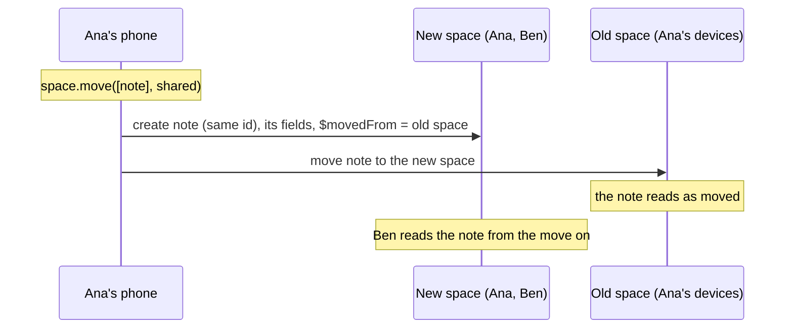

# RFC 0016: Moving an object to another space

REQUEST FOR COMMENTS · NOVEMBER 2026 · Ticket NOC-447

This RFC lets an app move an object, such as a note, from one space to another. Sharing a single note with a collaborator needs it: membership is per space, so a note that sits in a personal space or a project can only be shared alone once it lives in a space of its own. Without a move, an app can only copy the note into a new space and delete the original, which gives the note a new id, cuts its history and leaves every link to it pointing at a deleted object ([The problem](#the-problem)).

It builds on the object model of [RFC 0002](0002-change-and-log-format.md) and [RFC 0004](0004-merge-rules-basic-types.md), and on the person keys of [RFC 0003](0003-keys-and-cryptography.md); [How this RFC relates to the others](#how-this-rfc-relates-to-the-others) names the rest.

**How to give feedback.** Start a discussion in the category [RFC feedback](https://github.com/nocentraldb/nocentraldb/discussions/categories/rfc-feedback), naming RFC 0016 and the section you mean, or open a pull request against this file to change its text. [Giving feedback](README.md#giving-feedback) says how, and what happens to your point.

**Status.** Decided, 2026-11-22. RFC 0002, RFC 0004, RFC 0005 and RFC 0009 do not describe the move yet; the [follow-up tickets](#follow-up-tickets) rewrite them and build it.

**At 0.1.** Not built. Release 0.1 has no call that moves an object; an app copies and deletes.

**Out of scope.** Moving a whole space to another relay. Deleting a space, which the draft RFC 0014 designs. Moving an object between two databases that share no space. Rich text and streams, which carry their state as their RFCs define it; this RFC says only that a move carries a field's current value, whatever its type.

## Summary

| Question | Answer |
| --- | --- |
| What is a move? | Two changes, one in each space. The new space gets the object's current state as a create; the old space gets a **move**, an operation on the object that says where it went. A change never spans two spaces, so a move is not atomic, and the SDK writes the new space first. |
| Does the object keep its id? | Yes. The id stays; only the space changes. The old space keeps a **trace** under the same id, which reads as moved and names the new space. |
| What happens to its history? | It stays in the old space's log, signed as it was. The new space's history starts at the move. Edits to the object that the old space receives after the move, from members that had not seen it, are **later edits**: every member of the old space identifies them the same way, and the app can carry them over. |
| Its links and references? | Links between objects moved together stay. A link to an object left behind is cleared in the new space and counted. A link in the old space to the moved object reads `moved`, with the new space. A reference to the object follows the trace when the member holds the old space. |
| Its personal fields? | Sealed again under a person key of the new space, for the same person id, so one erasure still finds every copy. The person's own object must move along or already be in the new space. They are built after the rest. |
| Erasure? | An erasure that reaches both spaces shreds the person's key in each. A move erases nothing in the old space: the values it held stay sealed there under the old person key. |
| What do the members of the old space keep? | Everything they received up to the move: the history and the state at the move, in their log. Their view shows the trace without fields. They receive no change made after the move. The move returns a notice that says so. |
| Who may move? | A member that may write sealed changes in both spaces: a writer or an admin. |

## The problem

Ana keeps her notes in her personal space. She wants to share one note with Ben, and only that one. Membership is per space ([RFC 0008, "Roles and rights"](0008-membership.md#roles-and-rights)), so she cannot add Ben to the note alone. Without a move, her app:

1. creates a new space and adds Ben to it;
2. creates a new object in it with the note's fields, and gets a new id ([RFC 0002, "Object ids"](0002-change-and-log-format.md#object-ids));
3. deletes the note in her personal space ([RFC 0004, "Creating and deleting an object"](0004-merge-rules-basic-types.md#creating-and-deleting-an-object)).

Each step loses something the app has to rebuild:

- **The id changes.** URLs, bookmarks and the app's own tables that hold the old id now name a deleted object.
- **Links break.** A link in the personal space to the note reads `deleted`, and a reference from another space reads `missing`. Nothing tells the app where the note went.
- **Personal fields are lost or wrong.** The new object has no person key in the new space until the app writes each personal field again, and the app must remember to pass `samePersonAs`, or an erasure misses the copy ([RFC 0009, "Personal fields"](0009-sdk-api.md#personal-fields)).
- **Edits made offline are stranded.** If Ana's laptop edits the note while her phone shares it, the laptop's edit lands on the deleted original. A delete keeps it, but nothing says it belongs to the shared note.

The sub-agents' ad-hoc spaces copy objects in the same way and keep the source of each copy on the parent only ([RFC 0003, "Sub-agents get an ad-hoc space"](0003-keys-and-cryptography.md#sub-agents-get-an-ad-hoc-space)). That fits a copy that lives for one task. A move is meant to last, so every member of the old space must learn where the object went.

## Terms

| Term | Meaning in this RFC |
| --- | --- |
| Space, member, change, operation, object | As in RFC 0002. |
| Old space, new space | The space the object leaves and the space it goes to. |
| Mover | The member that moves the object. |
| Move | The operation the mover writes on the object in the old space: where the object went. |
| Trace | What the old space keeps of a moved object: its id, its move and its log. |
| Later edit | An operation on a moved object in the old space that is not in the causal past of the move that won. |
| Carry over | Writing later edits into the new space, as a new `write` there. |

## What a move is

A move is two changes, one per space, because a change never spans two spaces ([RFC 0002, "Operations: object, field and value"](0002-change-and-log-format.md#operations-object-field-and-value)):

1. **In the new space**, the mover writes a create of the object, with the same id, and one operation per field that holds a value: the state the mover's copy reads at the moment of the move. The same change sets the hidden field `$movedFrom` to the old space's id ([Formats](#formats)).
2. **In the old space**, the mover writes a **move** on the object, naming the new space.



**The new space first.** The SDK writes the new space's change before the old space's. If the device stops between the two, the object exists in both spaces, live, and the SDK writes the move when it opens again, from a pending record it keeps on the device. The other order would leave the object marked as moved while the new space does not hold it yet, so every other member would read it as gone. A duplicate loses nothing; a gap would hide the object.

**Not atomic.** The relay may accept one change and refuse the other, for example when the mover was removed from one space at the same time. The SDK reports a move whose second change was refused, and the app can try again or take the move back ([The SDK call and its notice](#the-sdk-call-and-its-notice)). No data is lost in either case: the old space's log holds the object's whole history until the move.

**Several objects at once.** A move takes a list of objects of one old space, so that a note and its attachments, or a project's tasks, move in one change per space. Links among them stay valid, because their ids do not change.

**Who may move.** The mover must be allowed to write sealed changes in both spaces: a writer or an admin of each ([RFC 0008, "Roles and rights"](0008-membership.md#roles-and-rights)). A writer of the old space can already read the object, copy it into any space where it writes, and delete it, so a move gives it no right it lacks. Requiring an admin of the old space was not taken: it would stop a writer from taking an object out of a team's project, but the writer can copy and delete anyway, so the rule would protect nothing and only make the honest path harder.

**Moving back, and moving again.** A move from the new space back to the old one writes a create in the old space with the same id and the current state, and sets the old space's move to `null`, which replaces the move the copy holds. RFC 0004's [two creates of one object id](0004-merge-rules-basic-types.md#two-creates-of-one-object-id) already make that one object, so the trace becomes the live object again, with its history before the first move intact. A move from the new space to a third space writes a move there; the old space's trace still names the new space, and a reader follows the traces one after the other ([References to the moved object](#references-to-the-moved-object)).

## The object's identity

A moved object keeps its id in the new space; only its space changes. An app names an object by its id and reads it through a space, as RFC 0009 already requires (`space.get(collection, id)`), so the move changes the space and leaves the name alone. The app's URLs and its own tables keep working, links between objects moved together stay valid, moving back revives the trace, and a reference needs only the new space to find the object, since a reference already names both, `{ space, id }` ([RFC 0004, "References"](0004-merge-rules-basic-types.md#references)).

GENESIS.md says every object belongs to exactly one space. That stays true of the live object; the old space keeps a trace that reads as moved and holds no fields in the view ([What the members of the old space keep](#what-the-members-of-the-old-space-keep)). Anything an app keys by the id alone, across spaces, must also look at the space. A hostile mover can move an object into a space that already holds that id; RFC 0004's rule for two creates of one id makes them one object, which a member that may write there could do anyway.

**Options not taken.**

- **A new id in the new space, which the trace names.** Each id would keep naming one object in one space, but the app would have to update every URL and table, links between objects moved together would have to be rewritten, and the trace would have to carry the new id.

## Its history

The old space's log holds every change ever made to the object, signed by its authors, sealed under the old space's keys. That log cannot be carried as it is: each change's signature and encryption bind it to its space ([RFC 0003, "How a member signs and encrypts a change"](0003-keys-and-cryptography.md#how-a-member-signs-and-encrypts-a-change)), and only the old space's members hold its keys.

So the new space's history starts at the move, and the old space keeps the rest, verifiable as it always was. The new space's members read the object's state, not how it got there: a note shared with Ben does not show him Ana's drafts. Every change stays provable in the space it was signed in, and the format needs nothing beyond the move. A member of the new space only cannot see who changed what before the move; a member of both spaces can, through `$movedFrom`. Principle 3 asks that nothing be lost silently: nothing is lost here, and the move's notice states the split.

**Conflicts at the move.** A field may hold a winner and readable conflicts, and a set may hold lost removals ([RFC 0002, "A late change stays identifiable"](0002-change-and-log-format.md#a-late-change-stays-identifiable)). The move writes each field's winning value, as every `write` resolves the conflicts its copy holds ([RFC 0009, "Field operations per field type"](0009-sdk-api.md#field-operations-per-field-type)). The conflicts stay readable in the old space's log, and the move's result lists the fields that held one, so an app can show them before it moves.

**Options not taken.**

- **The mover writes the history into the new space.** The new space would show every earlier version and author, but the mover would restate other members' changes in its own signed change, which the new space could not verify, because the original signatures cover ciphertext under keys it does not hold. The new space's members would also read every draft, which a share of the current note does not intend.
- **The old space's keys go to the new space's members.** The original changes would stay verifiable, but the new space's members would get the whole old space, every other object included: the opposite of sharing one note, and against GENESIS.md's rule that nobody gets more than its spaces.
- **Refusing to move an object with conflicts.** An object that is never edited again would keep its conflict for good, and could then never be shared.

### Later edits

Bob's laptop is offline and edits the note while Ana's phone moves it. The laptop's edit reaches the old space after the move, and it is concurrent with it. The SDK refuses to write to an object its copy reads as moved, with the error `moved`, so an honest member writes a later edit only when it had not seen the move.

A later edit is an operation on the moved object, in the old space, that is not in the causal past of the move that wins ([Two moves at once](#two-moves-at-once)). Each member computes this from the old space's changes alone, as it computes a concurrent loser ([RFC 0002, "A late change stays identifiable"](0002-change-and-log-format.md#a-late-change-stays-identifiable)), so every member of the old space finds the same set in any order of arrival. A later edit is kept and folded onto the trace, where `space.inspect` shows it; it never reaches the new space by itself.

The SDK reports later edits, and the app carries them over: `space.moves.laterEdits()` lists them per moved object, and `space.moves.carryOver(edits)` writes the chosen ones into the new space as one `write`. The app, or a person, decides whether an edit made before Ben's changes still applies, and every write is one the app asked for. The app needs a screen or a rule for it, and a member of both spaces must run it. Nothing is lost silently: the edits stay in the old space, identifiable on every member, and the SDK names them. An automatic carry-over can come later, as an option, once apps show how they use it.

**Options not taken.**

- **The mover's devices carry later edits over by themselves.** Bob's edit would appear in the shared note with no work by the app, but a device would write changes no one asked for, which RFC 0009 declined for re-sealing values ([RFC 0009, "Personal fields"](0009-sdk-api.md#personal-fields)). A carried-over edit gets a new stamp, so it would overwrite what Ben wrote since, although Ben's write was not concurrent to it. It would also wait until one of the mover's devices runs.
- **Any member of both spaces carries them over.** Faster, with the same faults, and two members might carry over the same edit twice.

### Two moves at once

Ana's phone moves the note to space T while her laptop, offline, moves it to space U. The move is a basic value of the object ([Formats](#formats)), so the old space converges on one winner by RFC 0004's rule, and the other move is a conflict that stays readable ([RFC 0004, "Basic values"](0004-merge-rules-basic-types.md#basic-values)). Both T and U hold a live object with the note's id. The SDK lists the lost move and its space in `space.moves.conflicts()`, so a member of both spaces can delete the stray object or move it back. Only members of the old space can see that the two are one note: a member of U alone cannot know that T exists. Principle 3 holds for the old space, where both moves are recorded; it cannot reach members who never held the old space.

## Its links and references

### Links in the moved object

A link points only into its own space ([RFC 0004, "Links"](0004-merge-rules-basic-types.md#links)). After the move, a link from the moved object to an object that moved with it stays valid, because the target kept its id. A link to an object left behind is cleared in the new space, and the move counts it in its result as `clearedLinks`, the same rule as an ad-hoc copy ([RFC 0009, "Sub-agents and ad-hoc spaces"](0009-sdk-api.md#sub-agents-and-ad-hoc-spaces)). The link stays readable on the trace in the old space; an app that wants it moves the target along. A reference in the moved object stays as it is: it names its target's space, and it resolves in the new space as it did in the old.

**Options not taken.**

- **Refusing the move until it includes every target.** No link would be cleared without the app knowing, but a note that links to one other note would drag the whole graph along, and the move of a single note would fail for a reason far from the note.
- **Turning the link into a reference.** The relation would survive, but a link field cannot hold a reference: the field's type would change, which the schema forbids ([RFC 0005, "The additive-change rule"](0005-schema-and-model-lock.md#the-additive-change-rule)).

### Links to the moved object

A link in the old space to the moved object finds the trace, and reads a new status, `moved`, with the new space. The SDK reads it as `{ status: "moved", space }`, so the app can show "moved to a shared note" or read the object there, if its member holds the new space. The link itself stays as written; only how it resolves gains a status, and its merge rule does not change. The status is a function of the old space's copy, as every link status is, so it converges ([RFC 0004, "Resolution"](0004-merge-rules-basic-types.md#resolution)). It is a fifth status for every app that reads links. Computed fields and views, once a later RFC designs them, treat a moved target as one they cannot follow, since it lives in another space, as they never follow a reference (principle 2).

**Options not taken.**

- **Reading the link as `deleted`.** No new status, but the app could not tell a moved object from a deleted one, which is the problem this RFC exists to solve.

### References to the moved object

A reference names a space and an object ([RFC 0004, "How a reference resolves"](0004-merge-rules-basic-types.md#how-a-reference-resolves)). After a move, a reference that names the old space finds the trace, and resolution follows it: the SDK follows the traces, up to 8 in a row so that a cycle of moves ends, and resolves the reference to `ok`, `notAccessible` or `missing` where the object is now. A reference keeps working with no write. Resolution is already local to each member and never part of the shared state, so following a trace breaks no convergence, and the three states stay as RFC 0005 named them. The read gives the space where it found the object, so an app that wants the reference to name the new space writes it once, as it writes any reference. A member that does not hold the old space cannot follow the trace and reads `notAccessible`, even when it holds the new space.

**Options not taken.**

- **Reading the reference as `missing` until the app rewrites it.** No change to resolution, but every reference to a moved object would break until some member rewrites it, and only a member of the referencing space can.

## Its personal fields

A personal value is sealed under the person key of its space, and the seal binds the space id and the object id ([RFC 0003, "Personal value"](0003-keys-and-cryptography.md#personal-value)). It cannot be carried as it is: the new space's members do not hold the old space's person key, and the seal names the old space.

So the move seals personal values again under a person key of the new space, for the same person id. The field arrives readable, one key per person per space holds ([RFC 0003, "The person key"](0003-keys-and-cryptography.md#the-person-key)), and the person id carries over, so an erasure finds both spaces, as `samePersonAs` does ([RFC 0005, "Identifying the person"](0005-schema-and-model-lock.md#identifying-the-person)). A new person key in the new space means a person-key entry and a record there. This part is built after the rest ([Follow-up tickets](#follow-up-tickets)); until then the SDK refuses to move an object that holds a personal value, with `notAllowed`. The move then works like this:

- **The object is the person** (`person: "self"`). Its hidden field `$person` moves with the same person id and a new person-key id, drawn for the new space, and its personal values are sealed under the new space's person key.
- **The object names its person by a link** (`person: "assignee"`). The person's object must move along, or the new space must already hold an object with the same person id in a collection the link allows; the SDK then sets the link to that object. Otherwise the move is refused with `noPerson`, naming the field, as RFC 0009 refuses a write that seals under no person. Choosing a person would guess.
- **The mover must hold the person key.** Otherwise the move is refused with `personKeyNotHeld`, as a write is, and the app retries once sync has fetched the key ([RFC 0009, "Personal fields"](0009-sdk-api.md#personal-fields)).
- **An erased field arrives unset.** A field whose person key a shred destroyed, finally or provisionally, reads as unset, so the move carries nothing for it. A provisional erasure that is taken back later restores the value in the old space's trace only.

**Options not taken.**

- **Personal fields stay behind, and the move counts them.** Nothing about the person would reach the new space, but the note would arrive without fields the user expects, and the app would have to write them again, by hand, under the right person.
- **An object with personal values cannot be moved.** Nothing to design, but a customer record or a note about a person could never be shared alone. The SDK refuses such a move only until personal fields in a move are built.

## Erasure

After the move, the person's data lives in two places: in the new space, sealed under the new person key, and in the old space's log, where every earlier value stays sealed under the old person key.

A move erases nothing, as removing a member erases nothing ([RFC 0005, "About whom, not by whom"](0005-schema-and-model-lock.md#about-whom-not-by-whom)). The person key in the old space keeps serving the person's other objects there, and no new rule is needed: an erasure by the person id shreds the key in each space of the database where the performer may write ([RFC 0003, "The person key"](0003-keys-and-cryptography.md#the-person-key)). Until an erasure, the old values stay readable to the old space's members, and the move's notice says that they keep what they received. An app that must remove a person's data from the old space erases the person, which reaches every space where it lives, the new one included. An erasure by a member who is not in both spaces reaches only the spaces it may write in.

**Options not taken.**

- **The move shreds the old person key.** The old values would become unreadable at the move, but the person key belongs to the person, not the object: shredding it would erase the person's other objects in the old space too. A shred is also final and needs a second account's sign-off, which a move does not have ([RFC 0003, "Shredding a person's key"](0003-keys-and-cryptography.md#shredding-a-persons-key)).

## What the members of the old space keep

Every member of the old space holds the object's log up to the move, under keys it already has. Nothing can take that back, as a removal cannot ([RFC 0003, "Removing a member and rotating the space key"](0003-keys-and-cryptography.md#removing-a-member-and-rotating-the-space-key)). What the design decides is only what the view shows.

The trace shows no fields. The view keeps no plaintext of the moved object's fields, so no index holds them, as for an erased field ([RFC 0006, "What the view stores in plaintext"](0006-local-view.md#what-the-view-stores-in-plaintext)). The object leaves the old space's queries, indexes and pages, as the app means it to; a read returns the trace with the new space, and `space.inspect` shows the history. That is about what the app reads, not what the device holds: the log keeps every earlier change, and the move's notice says so. What the old space's members keep:

- **The history and the state at the move**, in their log and in any archive, readable to every member of the old space, a member who joins later included.
- **No change made after the move.** Later changes are written in the new space, under keys they do not hold, unless they are members of it too.
- **The move itself**: that the object moved, when, by whom, and to which space id. They learn nothing of the new space's content or members.

The old space's key does not rotate. Rotating would protect nothing: the members already hold every change about the object, and no later one is written in the old space.

**Options not taken.**

- **The trace keeps its last state readable.** Old members would still see the note as it was, but it would show in two places, the old one frozen, and the app would have to hide it from every query itself.

## What the relay sees

The relay sees two changes by one author, in two spaces, close together in time, and their sizes ([RFC 0002, "What the relay can see, and what it cannot"](0002-change-and-log-format.md#what-the-relay-can-see-and-what-it-cannot)). It may guess that something passed from one space to the other, as it may for a copy. It cannot see the object, its id, the move or `$movedFrom`, which are all inside sealed payloads. Sharing a note in a new space adds the new space's genesis and the add of each new member, which the relay reads as it reads every control change. The move adds no control change and nothing the relay must check.

## The SDK call and its notice

The names follow RFC 0009's conventions.

```ts
const shared = await db.spaces.create();
await shared.members.add(bensInvitations, { role: "writer" });

const moved = await personal.move([note], shared);
moved.notice;       // { code: "objectMoved", text: "The members of the old space keep the history of these objects and their state at the move, and see no change after it. The members of the new space read them from the move on, not their history." }
moved.ids;          // the moved ids, in the order given
moved.clearedLinks; // 0
moved.conflicts;    // fields that held a conflict, resolved by the move

const later = await personal.moves.laterEdits();   // [{ id, edits }]
await personal.moves.carryOver(later[0].edits);
```

- **`space.move(objects, destination)`** takes objects the SDK read, as `createAdHoc` does, all from this space, and a space handle. It writes the new space first, then the old, and resolves once both are folded on this device. A refused change on either side shows in `space.status` and in `db.sync`, as for any write.
- **It refuses**, with nothing written: an object of another space or one that is already moved (`invalidValue`); a mover that may not write in either space (`notAllowed`, `notMember`); a destination of another model (`spaceOfAnotherModel`); and, for personal fields, `noPerson` and `personKeyNotHeld`.
- **The notice `objectMoved`** says what the move does not do, as every call that changes who can read does ([RFC 0003, "How the SDK hides keys"](0003-keys-and-cryptography.md#how-the-sdk-hides-keys)). It is the notice of moving data between spaces that RFC 0003 says comes later.
- **A write to a moved object** is refused with `moved`, which names the new space.
- **A read of the trace** gives `{ $id, $moved: { space } }` and no fields.
- **In Rust**, the same calls in snake case: `space.move_objects(&objects, &destination)`, since `move` is a Rust keyword.

## Formats

- **Move, operation 5**, on the object, with no field (key 3 absent), like delete: `{1: object id, 2: collection, 4: 5, 5: {1: destination, 2: replaces}}`. The destination is the new space's 16-byte id, or `null` to take a move back. It merges as a basic value of the object, as delete does ([RFC 0004, "Creating and deleting an object"](0004-merge-rules-basic-types.md#creating-and-deleting-an-object)). It takes the first number of RFC 0004's reserved range 5 to 63 ([RFC 0004, "Operation numbers"](0004-merge-rules-basic-types.md#operation-numbers)); numbers 0, 4 and 5 then belong to the object. An old core parks it as an unknown operation, so it shows the object as live until it upgrades, and its edits there become later edits. A set on a reserved field `$moved` was not taken, for the reason RFC 0004 gives for deletion: a member without the special case would read it as a write to an unknown field.
- **`$movedFrom`**, a hidden field set in the new space's change: `{1: old space id}`, merged as a basic value, as `$person` is ([RFC 0005, "Identifying the person"](0005-schema-and-model-lock.md#identifying-the-person)). It lets a member of both spaces find the history, and tells the new space's members the old space's random id and nothing more. Leaving it out was not taken: the new space would learn nothing of where the note came from, but no member, Ana included, could find its history from the new space.
- **A move and a delete are independent values.** A trace can also be deleted; a delete written after the move in the old space is a later edit.

## What this does not do

Stated plainly (principle 4):

- **It takes nothing back.** The old space's members keep the history and the state at the move. A move out of a project into a private space hides the object from the project's future, not from its past.
- **It is not atomic.** The two changes can be accepted or refused apart. The SDK writes the new space first, so the failure leaves a duplicate, not a gap.
- **It erases nothing.** Personal values stay sealed in the old space under the old person key until the person is erased.
- **The new space starts at the move.** Its members cannot see or verify who changed what before it, unless they also hold the old space.
- **Two moves at once leave two live objects**, in two spaces, and only members of the old space can tell.
- **Later edits do not follow by themselves.** They stay in the old space until the app carries them over.
- **Old clients see the object as live** in the old space until they upgrade, and their edits there become later edits.

## Agreement with GENESIS.md

- **Principle 1, the relay never reads content.** Serves it: the move, the destination and `$movedFrom` are sealed; the relay sees two writes, as for any copy.
- **Principle 2, every copy converges.** Serves it: the move is a basic value with RFC 0004's rule, later edits and the `moved` link status are functions of the old space's changes, and reference resolution, which follows traces, stays local information as it already is.
- **Principle 3, nothing is lost silently.** Touches it in three places, and the design keeps each identifiable: the history stays in the old space instead of following the object; conflicts are resolved by the move, as by every `write`, and listed in its result; later edits stay in the old space, on every member, until the app carries them over. Two concurrent moves are identifiable only to members of the old space.
- **Principle 4, say plainly what it does not do.** Serves it: [What this does not do](#what-this-does-not-do) and the notice `objectMoved`.
- **Principle 5, developers do not handle keys.** Serves it: the SDK seals personal values again under the new space's person key; the app passes objects and a space.
- **Principle 6, apps read only computed results.** Serves it: a trace leaves the old space's indexes; a moved link target is never followed by a computed field.
- **Principle 7, one core.** Serves it: the move is core logic, the same natively and in the browser.

It touches GENESIS.md's "every object belongs to exactly one space": the id stays, and the old space keeps a trace with no fields, not the object. It follows "never give an agent more than its spaces": the new space's members get the state, not the old space's history or keys.

## Follow-up tickets

These tickets build the design:

- **Rewrite the decided RFCs**: operation 5 and the `moved` link status in RFC 0004, `$movedFrom` in RFC 0005, the call, its errors and its notice in RFC 0009, and RFC 0003's sentence on the notice that comes later.
- **The move in the core and the Rust SDK**, without personal fields: both changes, the pending record, the trace, later edits, two moves at once, links and references; convergence tests in the harness for the move and later edits in any order of arrival.
- **The move in the TypeScript SDK**, after the Rust SDK.
- **Personal fields in a move**, with the person-key entry in the new space and the test that one erasure reaches both spaces.
- **RFC 0015's user journey** says how to share a single note with a move.

## How this RFC relates to the others

It adds an operation to [RFC 0002](0002-change-and-log-format.md)'s format and [RFC 0004](0004-merge-rules-basic-types.md)'s table, a link status to RFC 0004's links and a step to its references' resolution, and a hidden field to [RFC 0005](0005-schema-and-model-lock.md); it seals personal values under [RFC 0003](0003-keys-and-cryptography.md)'s person keys and gives the notice RFC 0003 left for later; it checks rights by [RFC 0008](0008-membership.md)'s roles; it keeps the view as [RFC 0006](0006-local-view.md) defines it; and it adds calls to [RFC 0009](0009-sdk-api.md). It serves the user journey of RFC 0015 (#423), which needs a single note shared, and leaves deleting a space to the draft RFC 0014.

## History

- 2026-11-22 · First published (NOC-447)
