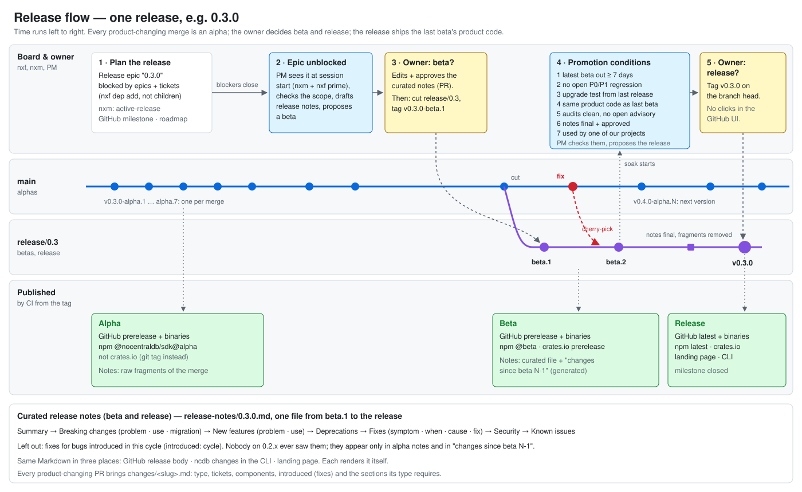

# Release management and versioning — design

Date: 2026-10-31. Status: draft for the owner's approval.

## Intent

NoCentralDB will ship a Rust core, a Rust SDK, the TypeScript SDK `@nocentraldb/sdk`, the CLI `ncdb` and a relay. Before the first real release we want one release process that:

- turns every merged change into something testable right away (alpha),
- lets the owner decide when a planned release is ready to be tried (beta) and when it is final (release), by tags rather than by clicking in GitHub,
- produces release notes people actually read: short, ordered by what matters to a user, explaining problems and fixes, and free of noise from the development cycle.

The sibling project nexus-flow (`../../nxsflow/nexus-flow`, `docs/specs/release-management.md`, `changes/README.md`) is the starting point. It requires a change fragment per PR, which we keep. What we change, and why:

- In nexus-flow, stable promotion is a manual step in the GitHub UI followed by a release-notes PR. Here every stage is a tag.
- Its notes are long, dense, grouped only by added/changed/fixed/removed, and read like commit messages (see https://nxsflow.com/changelog). Here they are curated and structured for a reader.
- Its stable notes aggregate every fragment since the last stable, including bugs that only ever existed between two releases. Here those are filtered out.

`release-flow.svg` is plain SVG. GitHub renders it in this document (no Mermaid), and it follows the reader's light or dark colour scheme. The release documentation can reuse it.

## Goals

1. One version number for everything the project publishes (crates, npm packages, CLI, relay), always in lockstep.
2. Every merge to `main` that changes the product becomes an alpha automatically.
3. Releases are planned on the board and shown publicly (GitHub milestone, landing-page roadmap). A release passes through beta before it is released.
4. A beta is proposed by an agent when its scope is met; the owner decides. A release is proposed when the promotion conditions hold; the owner decides.
5. Release notes are curated Markdown for beta and release, raw fragments for alpha, and the same text appears in GitHub, in the CLI and on the landing page.
6. Supply-chain hygiene from the first release: provenance, automated breaking-change detection, no long-lived publish tokens.

## Non-goals

- Building the nexus-flow GitHub Issues integration. It was filed there as `6j6v.qv39`; until it exists, the milestone mirror below is done by hand or by a small script.
- Long-term support. A `release/X.Y` branch exists to stabilise one minor line and ship its patches (see Branches); we do not maintain older lines in parallel. We may add that after 1.0.
- Translating release notes. They are English only (project rule: artifacts in English).

## Anti-goals (would count as failure even if it works)

- Release notes that list every merged change, or mention a bug a user of the previous release never had.
- A release that needs the owner to click through the GitHub UI, or to merge a follow-up PR, to become "latest".
- A release whose artifacts were not built by CI from a commit that CI tested.
- Publishing that depends on a token sitting in a developer's home directory.

## Versioning

- SemVer with prerelease suffixes. Tags: `v0.3.1-alpha.4`, `v0.3.1-beta.2`, `v0.3.1`.
  - This differs from nexus-flow on purpose: the stage is part of the version, so registries understand it.
- **Where the version lives (my call):**
  - Committed manifests hold only the plain version `X.Y.Z`, never a stage suffix. That means the `[workspace.package] version` in `Cargo.toml`, which crates inherit and which does not exist yet, and every published `package.json`.
  - CI writes the full version (`X.Y.Z-alpha.N`, `X.Y.Z-beta.N` or `X.Y.Z`) into the manifests of its build checkout from the tag, right before building and publishing. Nothing about the stage is committed. That is what lets the release sit on the beta's product code.
  - CI fails if the manifests disagree with each other. For beta and release tags it also fails if the tag's `X.Y.Z` does not equal the manifests.
- **Published packages (owner's decision):**
  - crates.io: `ncdb-core` (core), `nocentraldb` (Rust SDK) and `ncdb` (the CLI, so that `cargo install ncdb` works).
  - npm: `@nocentraldb/sdk`.
  - GitHub releases: CLI and relay binaries.
  - All of them carry the shared version.
  - The unscoped npm `nocentraldb` stays a parked `0.0.0` placeholder outside the shared version.
  - The first publish of each package is done once by hand by the owner, because Trusted Publishing can only be configured for a package that exists. Every later publish goes through CI.
  - `@nocentraldb/sdk` loses `private: true` and gets a build output before it ships.
- The next version is derived from the fragments since the last release:
  - any `breaking` → bump minor before 1.0, major from 1.0 on;
  - any `feature` → bump minor;
  - otherwise bump patch.

  Alpha and beta numbers count up within that target version. If a later fragment raises the bump (a feature arrives during `0.3.1-alpha.*`), the next alpha moves to `0.4.0-alpha.1`. The alpha job computes this itself. The committed manifest version is only raised when a release branch is cut (see Branches).

## Branches (owner's decision: release branches)

- `main` always moves forward and produces alphas of the next version.
- **Cutting the branch:** when the owner approves a beta, `release/X.Y` is cut from `main`. Betas and the release of `X.Y.Z` come from that branch only.
  - On the branch, a commit sets the manifests to `X.Y.Z`.
  - On `main`, a commit sets the manifests to the next minor `X.(Y+1).0`, so `main`'s alphas sort above the release line.
- **Fixes during beta** land on `main` first, with their fragment, and are cherry-picked to the branch, fragment included. Nothing is merged to the branch that is not on `main`, except the release notes and the manifest version.
- **Which fragments belong to which release:**
  - The fragments present at the cut belong to `X.Y.Z`.
  - So does every fragment cherry-picked to the branch afterwards.
  - After the release, a commit on `main` removes from `main` every fragment that shipped in `X.Y.Z`, so the next release's notes never repeat it.
- **Patch releases:** `X.Y.(Z+1)` follow on the same branch, through beta again.
- The placeholders on crates.io and npm are at `0.0.0`. The first real release must be above that. `crates/ncdb-core` loses `publish = false` when it first ships.

## Planning a release

- Each planned release has one epic on the board, e.g. "Release 0.3.0". Its description states roughly what must be true for the release.
- Epics and individual tickets that the release needs are attached as dependencies, not as children: `nxf dep add <release-epic> <item>`. A dependency blocks; a parent only groups, and a deferred or closed parent would hide its children.
- The release epic is mirrored publicly:
  - as a GitHub milestone (title = version, description = the public part of the epic);
  - as an entry on the landing page's roadmap.

  Until `6j6v.qv39` exists, this is a manual step (or a small script) when the release is planned and when its scope changes. Which items appear publicly is decided per item; the default is not public.

## Stages

### Alpha — every product-changing merge

On every push to `main`, after the `gates` job is green:

1. Compute the next version (see Versioning). Commit nothing.
2. Tag `v<next>-alpha.<n>` on that commit.
3. Build and publish:
   - GitHub prerelease with the alpha notes;
   - CLI and relay binaries attached to it;
   - npm under the dist-tag `alpha`.

Alpha notes = the raw fragments of this merge, rendered as Markdown, plus a link to the previous alpha.

Merges whose fragments are all `internal` (or that need no fragment) produce no alpha.

**My call:** alphas go to GitHub and the npm `alpha` dist-tag, but not to crates.io. crates.io versions are permanent, and publishing one per merge would bury the real versions. Rust users who want an alpha depend on the git tag. Betas and releases go to crates.io.

### Beta — proposed by an agent, decided by the owner

1. When the release epic is no longer blocked, an agent checks the epic's description against what was delivered.
   - If the scope is met, it proposes a beta to the owner and attaches a draft of the release notes.
   - If not, it says what is missing.
   - **How the owner hears about it (owner's decision):**
     - `nxc` has no way to reach a person, so nothing is pushed.
     - The release in progress is recorded as a memory: `nxm remember … --key active-release`, naming the version and the release epic's id. It is updated when a release ships or the next one is planned.
     - The PM persona receives both `nxm prime` and `nxf prime` at session start. It therefore sees the active release and whether its epic is still blocked.
     - Once the epic is no longer blocked, the PM raises it with the owner in its next session, and checks the scope.
     - The promotion conditions below are checked the same way.
     - These checks run in agent sessions, not in GitHub Actions: the board (`.nxs/`) is local and not synced, so CI cannot read it.
     - The agent reads GitHub (`gh`) for the facts that live there: CI status, release dates and tags.
     - A way for `nxc` to notify the owner has been requested from nexus-flow. It is not needed for this design.
2. Curation. The agent drafts `release-notes/<version>.md` (see Release notes) from two sources:
   - every fragment since the previous release;
   - every board item created or closed since the release epic was created.

   The owner edits and approves the draft in a PR.
3. On approval, `release/X.Y` is cut (see Branches), the approved notes are committed on it, and the tag `v<version>-beta.1` is pushed on the branch head.
   - The beta publishes to GitHub as a prerelease with the curated notes, to npm under the dist-tag `beta`, and to crates.io as a prerelease version.
   - The beta notes are the curated file plus a "Changes since beta N-1" section for betas after the first.
4. Fixes during beta land on `main` (where they produce alphas of the next version) and are cherry-picked to `release/X.Y`. Their fragments carry `introduced: cycle` or `introduced: <released version>`. The owner may cut `beta.2`, `beta.3`, … on the branch. The curated file on the branch is updated in a PR to the branch before each beta tag.

### Release — promotion conditions, then a tag

The agent checks these conditions continuously and proposes the release to the owner when all hold. The owner decides.

1. **Soak:** the latest beta has been out for at least 7 days with no newer beta.
2. **No open regressions:** no open bug of P0 or P1 whose `introduced` is this cycle. Lower ones are listed under Known issues.
   - Open bugs have no fragment yet, so the agent derives `introduced` from the bug ticket's description: when it was first seen, and which version or change it came with. If the description does not say, the agent asks rather than guesses.
   - The bug's fragment records the value when the fix lands.
3. **Upgrade tested:** an automated test upgrades from the previous release to the candidate.
   - It covers stored data, `model.lock.json`, an old client against the new relay, and a new client against the old relay.
   - Convergence must hold throughout.
4. **Same product code:** the release is tagged on the head of `release/X.Y`.
   - Since the last beta tag, only `release-notes/` and `changes/` may have changed. CI checks this with a diff and refuses the release tag otherwise.
   - The release is rebuilt (the version is embedded in the binaries, so the bytes differ), and CI is green on that commit.
5. **Security:** `cargo audit` and `pnpm audit` are clean, and no security advisory is open.
6. **Notes approved:** the curated notes are final and approved by the owner. Every breaking change has a migration section.
7. **Real use:** at least one of our own projects runs the beta with no new bug report.

Before 1.0, conditions 1, 2, 4 and 6 apply from the first release. Conditions 3, 5 and 7 apply as soon as there is a relay and a real user, respectively. The checks for 3 and 5 should be built when the relay and the dependency graph make them meaningful.

On approval, push `v<version>`. CI then:

- builds from that commit;
- publishes to crates.io, to npm under `latest`, and as a GitHub release marked latest, without a manual step;
- closes the milestone and updates the landing page.

## Change fragments (one per product-changing PR)

- **Location:** `changes/<slug>.md`, with YAML front matter and a Markdown body.
- **Enforcement:** CI fails a PR that changes product code without one.
  - It passes PRs that only touch docs, CI, tests, or repo tooling, by an allowlist of paths.
  - A `skip-changes` label exists as an escape hatch.
- **Lifecycle:**
  - Fragments are not deleted at alpha or beta.
  - On `release/X.Y`, the release's fragments are removed once the release notes are final, in the last notes PR before the release tag.
  - On `main`, they are removed after the release (see Branches).
  - Git history keeps them.

Front matter fields:

| field | values | required |
|---|---|---|
| `type` | `breaking`, `feature`, `fix`, `deprecation`, `security`, `internal` | yes |
| `tickets` | nxf ids, e.g. `[mt08.1qaz]` | yes |
| `introduced` | for `fix`: `cycle` (the bug only existed since the last release) or the released version that introduced it | yes for `fix` |
| `components` | any of `core`, `sdk-rust`, `sdk-ts`, `cli`, `relay` | yes |

Required body sections by type:

- `breaking` / `feature`: **Problem** (what a user could not do or did badly), **Use** (how to use it, with a short example). For `breaking`, also **Migration** (what to change).
- `fix`: **Symptom** (what went wrong), **When** (in which situations it was visible), **Cause** (why it existed), **Fix** (how we solved it).
- `deprecation`: what is deprecated, the replacement, and the earliest version that removes it.
- `security`: a short public description and the advisory id, once published.
- `internal`: one line. Never shown in curated notes.

## Release notes

- **Format (my call):**
  - One Markdown file per release version, `release-notes/<X.Y.Z>.md`. It is the same file from `beta.1` to the release, edited on `release/X.Y` before each beta.
  - The "Changes since beta N-1" section of a beta's GitHub notes is generated at publish time from the fragments added since the previous beta tag, not committed.
  - A machine-readable index, `release-notes/index.json`, lists `version`, `stage` (`beta` or `release`), `date` and `path` per published beta and release. It is generated by the release workflow and committed back to `main`. The CLI and the landing page read it.
  - For an installed beta, `ncdb changes` shows the curated file as it was at that beta's tag.
- **Order of sections** in curated notes:
  1. A two- or three-sentence summary of the release.
  2. **Breaking changes:** each with the problem it solves, how to use it, and how to migrate.
  3. **New features:** each with the problem it solves, then how to use it.
  4. **Deprecations.**
  5. **Fixes:** each with symptom, when it was visible, cause, and fix.
  6. **Security.**
  7. **Known issues:** bugs introduced in this cycle that are known and not yet fixed, each with a workaround if there is one.
- **The filter:** a fix with `introduced: cycle` never appears in curated notes. A user of the previous release never saw that bug. The fix still appears in alpha notes and in the "Changes since beta N-1" section.
- **Tone:** factual, written for the user of the product. It may say why a feature is worth having, but it makes no claims the product does not back. Shorter is better: one paragraph per entry, plus a code block where it helps.
- **Where it appears:**
  - **GitHub:** the release body is the file's content.
  - **CLI:**
    - `ncdb changes` prints the notes of the installed version.
    - `ncdb changes <from>..` prints the curated notes of every release after `<from>`, never alpha fragments.
    - The CLI may print a one-line hint when a newer release exists.
    - The CLI renders the Markdown for the terminal itself.
  - **Landing page:** shows released versions only, rendered from the same Markdown and index, plus the roadmap from open milestones. The landing page does not exist yet; this file and the index are its contract.

## Supply chain and policies

1. **Provenance:** npm publishes with provenance, and the binaries get GitHub artifact attestations.
2. **Breaking-change detection:** `cargo-semver-checks` for the Rust crates, and an API report diff for the TS SDK (e.g. API Extractor). An undeclared breaking change fails CI: a change the tool reports as breaking needs a `breaking` fragment.
3. **No long-lived tokens:** publish to npm and crates.io through Trusted Publishing (OIDC from GitHub Actions). The owner's passkey-protected accounts stay out of automation.
4. **Withdrawal:** a broken published version is yanked on crates.io and deprecated on npm, and a fixed version follows at once. Nothing is deleted.
5. **Security advisories:** through GitHub Security Advisories, with a Security section in the notes.
6. **Deprecation policy:** anything to be removed is marked deprecated, and announced in the notes, at least one release before it is removed.

## What exists today

- CI: `.github/workflows/ci.yml` runs `pnpm gates` on PRs and on `main`.
- The repo is private on the free GitHub plan, so there is no branch protection (`mt08.may6`).
- **Owner's decision: the repository goes public before the first real release (0.1.0).**
  - Going public is a precondition of 0.1.0. On a private repo, GitHub releases, milestones and binaries are visible only to collaborators, npm provenance does not work, and artifact attestations need Enterprise Cloud.
  - Until then, alphas (and betas, if any) are published to GitHub only, visible to collaborators, and nothing is published to the registries.
  - Provenance, attestations, the public milestone mirror and branch protection (`mt08.may6`) switch on with going public.
- Published: the placeholders `nocentraldb` (npm and crates.io), `ncdb` and `ncdb-core` (crates.io), all `0.0.0`. The npm scope `@nocentraldb` is owned.
- Not yet existing: the CLI, the relay, the Rust SDK, the landing page. The process must work with what exists and grow as these appear:
  - parts with nothing to publish are skipped;
  - the CLI command arrives with the CLI;
  - the landing page consumes the files when it exists.

## Left to the builder

- Tooling: a Node script under `scripts/`, a Rust `xtask`, or an existing tool. It must fit the moon tasks and the gates.
- Workflow layout and job names. Whether alpha, beta and release share one workflow.
- How the agent's beta/release proposal is triggered.
- The exact upgrade-test harness, once a relay exists.
- Rendering Markdown in the terminal.

## Related

- nexus-flow `6j6v.qv39`: GitHub Issues and milestone integration for nxf (requested, not built).
- nexus-flow `6j6v.ek9g`: a way for nxc to notify the owner (requested, not built). Once it exists, the PM can tell the owner about a ready beta or release without waiting for the next session.
- `mt08.may6`: make `gates` a required check once the plan allows.
- `mt08.debh`, `mt08.sfqn`: Dependabot follow-ups.
